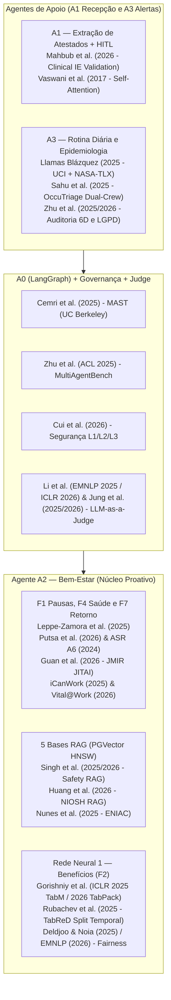
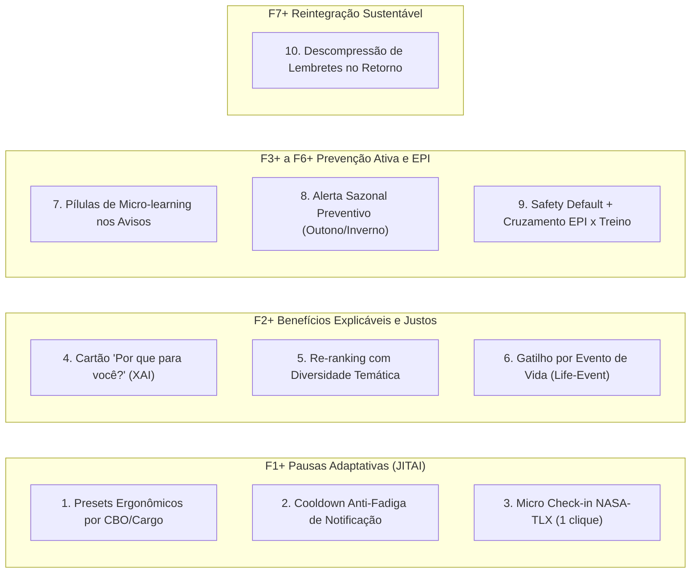

# Fundamentação Científica e Estrutura de Base de Dados — Projeto SinergIA (v2.2)

Este documento consolida a análise cruzada entre a documentação mais recente do repositório ([`Documentação - SinergIA v2.2.docx`](Documenta%C3%A7%C3%A3o%20-%20SinergIA%20v2.2.docx)), o modelo físico do banco ([`001_schema_inicial.sql`](../db/schema/001_schema_inicial.sql)), o pipeline experimental da Rede Neural ([`teste_rede_neural_simples.py`](../src/sinergia/modelos/rede_neural_beneficios/teste_rede_neural_simples.py)) e o acervo de **196 fontes** do caderno **"Arquitetura de Dados para Bem-Estar e Saúde Ocupacional"** no NotebookLM.

---

## 1. Diagnóstico da Documentação v2.2 e Alinhamento do Repositório

A transição da **v1.0** (fluxo linear reativo de triagem de atestados) para a **v2.1 / v2.2** reposicionou o **Agente A2 — Bem-Estar (CrewAI)** no centro da solução sob o princípio **"cuidado, não vigilância"**, sustentado em topologia estrela pelo **A0 (Orquestrador LangGraph)**, **A1 (Recepção e Processamento)** e **A3 (Apoio)**.

### 1.1 O que mudou da `v2.1.docx` para a `v2.2.docx`?
A inspeção diferencial (`diff`) entre [`Documentação - SinergIA v2.1.docx`](Documenta%C3%A7%C3%A3o%20-%20SinergIA%20v2.1.docx) e [`Documentação - SinergIA v2.2.docx`](Documenta%C3%A7%C3%A3o%20-%20SinergIA%20v2.2.docx) revela quatro ajustes importantes que impactam a fundamentação e os dados:
1. **Simplificação do Runtime da Rede Neural (Seções 5.1, 8, 9 e 14):** A `v2.2` removeu a exigência de exportação para `ONNX Runtime` no corpo principal, mantendo o treino e a inferência diretamente em **PyTorch** (alinhado com [`teste_rede_neural_simples.py`](../src/sinergia/modelos/rede_neural_beneficios/teste_rede_neural_simples.py)).
2. **Antecedência do Aviso de Fim de Vida Útil de EPI — F6 (Seção 5.1):** Passou de *"15 e 3 dias antes"* para **"30 dias antes"** (igualando-se à antecedência do vencimento de CA).
3. **Papel dos Usuários de Apoio (Seção 2):** Ajustado de *"mantêm os dados"* para **"consultam os dados de que o A2 precisa, de acordo com seus perfis de acesso"**, reforçando que os dados de origem (`cadastro`, `ponto`, `férias`, `catálogos`) são somente leitura.
4. **Nova Evolução Futura (Seção 13):** Inclusão da integração de autenticação com a árvore organizacional do **Microsoft Teams (Microsoft Entra ID / Graph API)** para mapeamento automático de cargos, setores e linhas de reporte.

> [!WARNING]
> **Inconsistências residuais para corrigir entre a `v2.2.docx` e o SQL/Anexos:**
> - **Cabeçalho interno da `v2.2.docx`:** A tabela da Seção 1 ainda exibe `Versão: 2.1` (vale atualizar o texto para `2.2`).
> - **Antecedência de EPI (30 dias vs. 15 dias):** Na Seção 5.1 (F6) da `v2.2`, o fim da vida útil do EPI passou para **30 dias**, mas a Seção 5.4 (A3.4), o exemplo D.4 e a visão `apoio.vw_epi_pendente` em [`001_schema_inicial.sql`](../db/schema/001_schema_inicial.sql#L515-L528) (`CURRENT_DATE + 15`) ainda usam **15 dias**.
> - **Menções remanescentes a ONNX:** Foram removidas do corpo da `v2.2`, mas ainda aparecem em [`README.md`](../README.md#L11), no comentário de `bem_estar.versao_modelo` ([`001_schema_inicial.sql`](../db/schema/001_schema_inicial.sql#L271)) e nos Anexos C.3 e E.5.
> - **Lacunas explícitas no texto da `v2.2.docx`:** A Seção 6 ainda contém `Limpeza dos Dados: [A detalhar pelo grupo]` e o Anexo G mantém pendências em aberto (Política de CID, Formulário curto, Judge síncrono em F2/F5 e Alvos da Rede Neural 2).

---

## 2. Estrutura da Fundamentação Científica (Artigos 2024–2026 do NotebookLM)

O caderno do NotebookLM consolida **17 referências centrais** (16 artigos e revisões de **2024 a 2026**, respeitando estritamente a janela de recência de 2 anos, mais o clássico fundacional de **Vaswani et al., 2017** para a base matemática de *Self-Attention*). Abaixo está a matriz que conecta cada módulo da `v2.2` à sua fundamentação científica:

### 2.1 Agente A2 — Pausas Ativas (F1), Saúde Ocupacional (F4) e Retorno (F7)
| Decisão Arquitetural na v2.2 | Artigo / Fonte no NotebookLM (2024–2026) | Evidência Científica e Métrica para Citar na Documentação |
| :--- | :--- | :--- |
| **Lembretes programados de pausa (F1)** | **Leppe-Zamora et al. (2025)** (*Int. J. Behav. Nutr. Phys. Act.*, v. 22, art. 75) e **Albulescu et al. (2022)** (*PLOS ONE*) | Meta-análise de 18 RCTs ($N = 1.164$ trabalhadores) comprova que prompts computacionais reduzem o tempo sentado em **$-12{,}5\text{ min/dia}$** e somam **$+1.030\text{ passos/dia}$**; micro-pausas $\le 10\text{ min}$ elevam o vigor ($d = 0{,}36, p < 0{,}001$) e reduzem a fadiga ($d = 0{,}35, p < 0{,}001$). |
| **Padrão de 5 min de pausa e janela de 30–240 min** | **Putsa et al. (2026)** (*npj Exerc. Med. Health*) e **Diretriz Alemã ASR A6 (2024)** / OSHA | A inatividade contínua após 25 min desencadeia fadiga muscular estática; pausas curtas e frequentes (~5 min por hora de tela) superam pausas longas espaçadas na recuperação fisiológica. |
| **Preferências do usuário (`preferencia_pausa`) e trava fora da jornada ("Cuidado, não vigilância")** | **Guan et al. (2026)** (*JMIR*, 28:e84422) e **Healthcare (2026, 14, 3852)** | Em *Just-in-Time Adaptive Interventions* (JITAIs), a **fadiga de notificação (*notification fatigue*)** é a maior causa de abandono; a retenção exige variáveis de personalização (*tailoring variables*) e cultura não punitiva que legitime o descanso. |
| **Acompanhamento em 3 marcos do afastamento (Proposta F7 — Anexo E.3)** | **iCanWork (2025)** (*Current Oncology*, 32(5):266) e **Vital@Work (2025/2026)** (PMC13636312) | Contato estruturado de apoio durante o afastamento elevou o retorno integral ao trabalho em 3 meses de **36,4% (controle) para 50,0% (intervenção)**, reduzindo a mediana de retorno de 11 para 8 meses. |

### 2.2 Engenharia das 5 Bases RAG (Seção 6 — `rag` + PGVector HNSW)
| Decisão Arquitetural na v2.2 | Artigo / Fonte no NotebookLM (2024–2026) | Evidência Científica e Métrica para Citar na Documentação |
| :--- | :--- | :--- |
| **Separação em 5 bases normativas de SST e Direitos** | **Singh et al. (nov. 2025 / fev. 2026)** (*arXiv:2511.11847v2* — *Manufacturing Safety Chatbot*) | Avaliou 24 configurações de RAG sobre normas OSHA, guias NIOSH e manuais de equipamentos (equivalentes às 5 bases do A2), atingindo **86,66% de acurácia**, latência média de **10,04 s** e custo de **US\$ 0,005/consulta**. |
| **Enriquecimento híbrido RAG (PGVector) + SQL determinístico** | **Huang et al. (jan. 2026)** (*Procedia Computer Science*, v. 289) e **Nunes et al. (2025)** (*ENIAC / SBC*) | Demonstram que a busca puramente vetorial falha em **identificadores operacionais atômicos** (números de CA, datas de vencimento, códigos de norma). Combinar PGVector (semântica) com SQL determinístico (`apoio.epi`, `vw_epi_pendente`) elimina alucinações numéricas. |

> [!TIP]
> **Texto pronto para preencher a lacuna `Limpeza dos Dados: [A detalhar pelo grupo]` na Seção 6 da `v2.2.docx` (baseado em Singh et al., 2025/2026):**
> *"Limpeza e Segmentação dos Dados: Seguindo o protocolo de curadoria de corpus para Saúde e Segurança do Trabalho de Singh et al. (2025/2026), o processamento no diretório `rag/` executa quatro etapas: (1) Curadoria exclusiva de fontes oficiais vigentes (NR-6, NR-7, NR-17, CLT e CAEPI/MTE) e documentos internos homologados; (2) Sanitização textual para remoção de cabeçalhos/rodapés repetitivos, quebras de página e artefatos de OCR/PDF; (3) Segmentação híbrida guiada por estrutura: documentos extensos com sumário (NRs, CLT, Manual do Colaborador) são particionados por capítulos e subcapítulos para preservar unidades instrucionais completas em `rag.trecho`, enquanto documentos técnicos curtos sem sumário (fichas de EPI, FAQs e roteiros de pausa) são subdivididos sob um teto de 3.000 palavras antes da geração dos embeddings de 768 dimensões; e (4) Padronização de metadados (`titulo`, `fonte`, `versao` e flag `vigente = TRUE`), garantindo rastreabilidade e substituição atômica quando uma norma é atualizada."*

### 2.3 Redes Neurais em Dados Tabulares e *Fairness* (Seção 5.1 — Rede Neural 1 e Anexo E.5 — Rede Neural 2)
| Decisão Arquitetural na v2.2 | Artigo / Fonte no NotebookLM (2024–2026) | Evidência Científica e Métrica para Citar na Documentação |
| :--- | :--- | :--- |
| **Arquitetura MLP com embeddings categóricos e normalização Z-score em PyTorch** | **Gorishniy, Kotelnikov & Babenko (ICLR 2025 — *TabM*; 2026 — *TabPack*)** (*arXiv:2410.24210v3* / *2607.05380*) | Benchmark em 46 datasets tabulares comprova que **MLPs acopladas a *feature embeddings*** oferecem a melhor relação entre acurácia, velocidade de treino e vazão de inferência, superando arquiteturas pesadas baseadas em atenção. |
| **Divisão temporal 80/20 antes da normalização (sem *Data Leakage*)** | **Rubachev et al. (2025 — *TabReD*)** e *arXiv:2502.20260v2* (2025) | Demonstram que a validação cruzada aleatória (*random split*) superestima modelos tabulares diante de mudanças de distribuição temporal (*temporal drift*); o corte cronológico estrito (80% treino / 20% teste) é obrigatório para validar produção. |
| **Exclusão de variáveis sensíveis (CID, IMC, ponto, sexo, raça) e *Cold Start* por cargo** | **Deldjoo & Noia (2025)**, **EMNLP Findings (2026)** (*Fairness in LLM RecSys*) e **ACPR (2026)** | Fundamentam a prevenção de discriminação direta (Art. 11 da LGPD) e alertam para o monitoramento de **variáveis *proxy*** (como cargo/setor) e viés de popularidade no loop de retroalimentação, auditando a `Precisão@3` desagregada por área. |

### 2.4 Orquestração em Estrela (A0 LangGraph), Protocolo `sinergia/1` e Avaliação *LLM-as-a-Judge*
| Decisão Arquitetural na v2.2 | Artigo / Fonte no NotebookLM (2024–2026) | Evidência Científica e Métrica para Citar na Documentação |
| :--- | :--- | :--- |
| **Topologia em estrela no A0, caixas-pretas isoladas e contrato JSON `sinergia/1`** | **Cemri et al. (2025 — *MAST*, UC Berkeley)** (*arXiv:2503.13657v3*) e **Zhu et al. (ACL 2025 — *MultiAgentBench*)** | A análise de 1.642 *traces* mostra que **41,77%** das falhas multiagentes vêm de especificação/desenho e **36,94%** de desalinhamento inter-agentes; cadeias sem orquestrador central amplificam erros em até **$17{,}2\times$** e elevam o gasto de tokens em **$15\times$**. |
| **Segurança em camadas (JWT/Argon2id, tabelas por contrato e `REVOKE UPDATE, DELETE`)** | **Cui et al. (2026 — *MADBench*)** (*arXiv:2609.39146v1*) e Protocolos **A2A / MCP (2025)** | Modela ataques multiagentes em 3 camadas: **L1 (Orquestração)**, **L2 (Agentes)** e **L3 (Recursos/RAG poisoning)**, validando o isolamento de permissões de banco do Anexo C e a flag `vigente = TRUE` no RAG. |
| **Avaliação *LLM-as-a-Judge* em 5 critérios (1 a 5) e Judge pré-envio para F2/F5 (Proposta E.6)** | **Li et al. (EMNLP 2025 / ICLR 2026)**, **LongJudgeBench (2026)** e **Jung et al. (2025) / *arXiv:2606.00093* (2026)** | Alerta contra *Preference Leakage* (exigindo modelo juiz diferente do redator no Groq), valida respostas curtas (Critério Clareza) para evitar degradação do juiz e prova que a **cascata de abstenção pré-envio** eleva a acurácia de **0,534 para 0,874**. |

### 2.5 Recepção de Atestados (A1) e Rotina Diária / Epidemiologia (A3)
| Decisão Arquitetural na v2.2 | Artigo / Fonte no NotebookLM (2024–2026) | Evidência Científica e Métrica para Citar na Documentação |
| :--- | :--- | :--- |
| **Extração estruturada com `interrupt` humano obrigatório e limiar de confiança 0,8 (E.2)** | **Mahbub et al. (abril 2026)** (*arXiv:2604.06028v1*) e **Vaswani et al. (2017)** (*Attention Is All You Need*) | Pipeline *human-in-the-loop* em dois estágios atinge **$\text{AUC} = 0{,}80$** provando que, na extração clínica, **falsos-positivos são mais graves que falsos-negativos** (nunca adivinhar campos com confiança $< 0{,}8$). |
| **Epidemiologia laboral (A3.2) e interação não-linear Carga $\times$ Saúde** | **Llamas Blázquez (2025)** (*Article 482* — Base Brasileira UCI $N = 740$) | Mostra que a carga de trabalho isolada tem correlação linear quase nula com a duração da falta (**$r = 0{,}0247$**), mas sua interação não-linear com o **CID-10 (28,5% de importância)**, **carga calibrada via NASA-TLX (22,2%)** e **sazonalidade (11,8%)** é altamente significativa (**$p < 0{,}001$**, Random Forest $\text{AUC} = 0{,}89$). |
| **Crews especializadas (A2 e A3) com *Safety Defaults*** | **Sahu et al. (2025 — *OccuTriage*)** ($N = 2.589$ casos clínicos ocupacionais) | Um LLM único erra em **45,38%–48,75%** dos casos; a divisão em *Crews* especializadas com RAG e travas pró-segurança reduz a discordância para **20,16%** (superando os 25,11% de triadores humanos) e cai a subtriagem crítica para **3,10%**. |
| **Auditoria completa (`orquestracao.*`), privacidade LGPD e dados sintéticos** | **Zhu et al. (2025/2026)** (Revisão de $>300$ estudos de Governança em Saúde Mental) | Fundamenta o framework de auditoria **6D**, o filtro de sanitização de privacidade ($F_{priv}$), o controle de divergência ($\sigma^2 < \epsilon$) e o uso de geradores sintéticos (**MoodAngels/TabSyn** e **MDD-5k**) para respeitar o Art. 11 da LGPD. |

---

## 3. Estrutura e Catálogo da Base de Dados do Projeto

Para alimentar o projeto de ponta a ponta (Apresentação/Contexto, `data/rag/`, `db/seeds/` nas 48 tabelas 3FN, `modelos/` e `tests/`), estruturamos os dados em **4 Categorias Operacionais**:

### 3.1 Categoria A — Base de Dados de Contexto, Mercado e *Big Numbers* (Seção 2 e Pitch)
Estes números estão auditados nas fontes do NotebookLM e prontos para entrar na **Seção 2 (Problema)** e no **Quadro 2 do Roteiro de Apresentação**:
1. **Dados Abertos do INSS / Consolidação Data Cajuína (2025–2026):**
   - **534.904 afastamentos** por transtornos mentais e comportamentais (CID-10 Cap. V: F00–F99, auxílio-doença espécie 31) em 2025 — **recorde histórico (+13,2% sobre os 472.328 de 2024)**, média de **44.575 afastamentos/mês**.
   - Representam **13,6% de todos os 3.933.701 auxílios-doença** do Brasil, com duração média de 3 meses e custo direto superior a **R\$ 3,5 bilhões ao INSS**.
   - **Concentração diagnóstica (93,2% nos Top 10 CIDs):** `F41` (Transtornos ansiosos) lidera isoladamente com **161.303 casos (30%)**, enquanto a soma dos quadros depressivos (`F32` com 124.221 + `F33` com 59.664) atinge **183.885 afastamentos**, seguidos por `F31` (60.459), `F19` (25.154) e `F43` (21.380).
2. **Marco Regulatório Brasileiro — Nova NR-1 (Portaria MTE nº 1.419/2024):**
   - Vigente desde **26 de maio de 2026**, obriga todas as empresas a incluírem o gerenciamento de **riscos psicossociais e ergonômicos** no PGR (Programa de Gerenciamento de Riscos).
   - **Impacto Econômico (OMS & JOEM):** 12 bilhões de dias de trabalho perdidos/ano no mundo (US\$ 1 trilhão/ano); a perda de produtividade ligada à saúde supera em **$2{,}3\times$** o gasto médico direto (Loeppke et al., $N = 51.648$), e ações preventivas geram **ROI de $5{,}6 : 1$** contra $3{,}4 : 1$ de ações reativas (Deloitte).
3. **Pesquisa Primária Própria do Grupo ([`Sinergia — Pesquisa_ Bem-estar e Prevenção- respostas.pdf`](Respostas%20-%20Pesquisa%20-%20SinergIA/Sinergia%20%E2%80%94%20Pesquisa_%20Bem-estar%20e%20Preven%C3%A7%C3%A3o-%20respostas.pdf), $N = 42$):**
   - **54,8%** dos respondentes não conhecem (16,7%) ou conhecem apenas parcialmente (38,1%) os canais para comunicar afastamento ou enviar atestado.
   - Entre os 64,3% que já precisaram se afastar, **48,1%** relataram dificuldades para obter informações ou orientações da empresa (30,9% da amostra total).
   - **85,7%** consideram "Muito importante" ou "Importante" identificar padrões coletivos de adoecimento preservando a privacidade (validando o alerta **A3.2** e a **Rede Neural 2**).
   - **81,0%** usariam um canal digital integrado para enviar atestados e receber orientações preventivas (e outros 14,3% "Talvez", somando **95,3% de receptividade**).

---

### 3.2 Categoria B — Corpora Oficiais para as 5 Bases RAG (`data/rag/` e Schema `rag`)
Para popular `rag.base_conhecimento`, `rag.documento` e `rag.trecho` (`vector(768)` com índice HNSW), cada pasta em `data/rag/` deve receber os documentos já presentes no NotebookLM mais os catálogos públicos correspondentes:

| ID / Nome em `rag.base_conhecimento` | Funcionalidade A2 | Fontes no NotebookLM e Bases Públicas para Ingestão em `data/rag/` | Tabelas SQL Cruzadas no Enriquecimento |
| :--- | :--- | :--- | :--- |
| `1` · `PAUSAS` | **F1** (Pausas personalizáveis) | • **NR-17 Atualizada (2022)** (PDF oficial MTE no NotebookLM) • **Diretriz Técnica ASR A6 (2024)** (pausas visuais/musculares de 5 min) • Guia interno sintético de ergonomia, alongamento, hidratação e descanso visual (`v2026.1`) | `bem_estar.tipo_pausa`, `bem_estar.preferencia_pausa`, `cadastro.colaborador` (`jornada_inicio`, `jornada_fim`) |
| `2` · `DIREITOS_BENEFICIOS` | **F2** (Direitos e recomendação de benefícios) | • **CLT e Normas Correlatas** (`clt_e_normas_correlatas_1ed.pdf` no NotebookLM: férias Art. 134 §1º, 13º, licenças, estabilidade acidentária Art. 118 Lei 8.213/91) • Política Interna de Benefícios e Regulamentos dos 5/12 benefícios (`v2026.1`) | `bem_estar.beneficio`, `bem_estar.colaborador_beneficio`, `bem_estar.recomendacao_beneficio` |
| `3` · `PROCEDIMENTOS` | **F3** (Procedimentos e treinamentos) | • **NR-01 Atualizada (2025/2026 — Portaria MTE 1.419)** (PDF no NotebookLM) • Descrições ocupacionais **O\*NET** (usadas em Sahu et al., 2025) • Manual do Colaborador, Política de Atestados (prazo de 2 dias úteis para entrega física) e Catálogo de Treinamentos (`v2026.1`) | `bem_estar.treinamento`, `bem_estar.cargo_treinamento`, `bem_estar.colaborador_treinamento` |
| `4` · `SAUDE_OCUPACIONAL` | **F4** (Exames, vacinas e eventos) | • **NR-07 Atualizada (2022 — PCMSO)** (PDF oficial MTE no NotebookLM: prazos de exames periódicos e exame de retorno $\ge 30\text{ dias}$) • Calendário Nacional de Vacinação do Adulto (MS) e Programação SIPAT/Campanhas (`v2026.1`) | `bem_estar.tipo_exame`, `bem_estar.cargo_exame`, `bem_estar.exame_colaborador`, `bem_estar.vw_proximo_exame`, `bem_estar.vacina`, `bem_estar.evento` |
| `5` · `EPI` | **F5 e F6** (Orientação, reposição e troca de EPI) | • **NR-06 Atualizada (2022 — EPI)** (PDF oficial MTE no NotebookLM) • **Base Pública CAEPI / MTE** (`caepi.mte.gov.br` — fichas reais de CAs, validade e instruções de conservação) • POP de Reposição de EPI (`v1.2`) | `apoio.epi`, `apoio.cargo_epi`, `apoio.entrega_epi`, `apoio.solicitacao_epi`, `apoio.vw_epi_pendente` |

---

### 3.3 Categoria C — Base de Dados Relacional (`db/seeds/`) e Treinamento das Redes Neurais (`data/uci/`)

O repositório já possui a base real brasileira [`Absenteeism_at_work.csv`](../data/uci/Absenteeism_at_work.csv) ($N = 740$ linhas, 21 colunas separadas por `;`, originada de 36 trabalhadores únicos ao longo de 3 anos em uma empresa brasileira, analisada por Llamas Blázquez, 2025).

Para construir o **Banco Semente "Empresa Fictícia" (`db/seeds/`)** exigido no Anexo F (**~120 colaboradores, 12 meses de histórico e situações plantadas para todos os alertas**) e alinhar o script da Rede Neural ao schema SQL ([`001_schema_inicial.sql`](../db/schema/001_schema_inicial.sql)), a estratégia recomendada pelas fontes do NotebookLM (*Llamas Blázquez, 2025* + *MoodAngels/TabSyn de Zhu et al., 2025/2026*) é:

#### 1. Mapeamento Direto: `data/uci/Absenteeism_at_work.csv` $\rightarrow$ PostgreSQL (`001_schema_inicial.sql`)
| Coluna no CSV da UCI (`Absenteeism_at_work.csv`) | Tabela / Visão Destino no PostgreSQL (`001_schema_inicial.sql`) | Regra de Transformação e Conformidade LGPD |
| :--- | :--- | :--- |
| `ID` (36 perfis base $\rightarrow$ expandir para 120 via amostragem estratificada *TabSyn*) | `cadastro.colaborador` (`id_colaborador`, `matricula`, `nome`, `email`) | Gerar 120 colaboradores distribuídos em 4 áreas e 8 setores (`cadastro.area`, `cadastro.setor`) e cargos com CBO real (`cadastro.cargo`). |
| `Age` (27 a 58 anos, média 36,4) | `cadastro.colaborador.data_nascimento` e `vw_features_beneficio.idade` | `CURRENT_DATE - make_interval(years => Age)`. Entra na Rede Neural 1. |
| `Service time` (1 a 29 anos, média 12,5) | `cadastro.colaborador.data_admissao` e `vw_features_beneficio.tempo_empresa_meses` | Convertido em meses na visão SQL (`tempo_empresa_meses`). Entra na Rede Neural 1. |
| `Son` (0 a 4 filhos) | `cadastro.colaborador.qtd_dependentes` | Mapeamento direto (`SMALLINT`). Entra na Rede Neural 1. |
| `Work load Average/day` (205,9 a 378,8 — calibrado via **NASA-TLX**) | `cadastro.colaborador` (`jornada_inicio`, `jornada_fim`) + `vw_features_beneficio.jornada_horas` | Calibrado pela equação de Llamas Blázquez (2025): $\text{Workload} = 1{,}7297 \times \text{NASA-TLX} + 205{,}917$. |
| `Reason for absence` (1 a 28 — Capítulos CID-10) + `Absenteeism time in hours` | `afastamento.cid` e `afastamento.atestado` (`codigo_cid`, `inicio_afastamento`, `fim_afastamento`) | Mapeia os grupos 1–21 para códigos reais da tabela oficial **DATASUS CID-10** (ex.: Cap. XIII `M54.5` dor lombar, Cap. X `J06.9`, Cap. V `F41.1` / `F32.1`). **Bloqueado para o A2 e para as Redes Neurais 1 e 2 (LGPD, Art. 11).** |
| `Distance from Residence to Work`, `Transportation expense`, `Education` | Gerador de adesão realista em `bem_estar.colaborador_beneficio` e `bem_estar.recomendacao_beneficio` | Usados apenas no script de *seed* para simular a matriz histórica de adesão sem ruído aleatório, conforme já implementado em [`teste_rede_neural_simples.py`](../src/sinergia/modelos/rede_neural_beneficios/teste_rede_neural_simples.py#L40-L46). |
| `Body mass index`, `Social drinker`, `Social smoker`, `Disciplinary failure` | **Descartados na ingestão do banco (`NUNCA` entram no SQL nem nas Redes Neurais)** | Princípio **"Cuidado, não vigilância"** e minimização de dados sensíveis (LGPD, Art. 6º, III e Art. 11). |

#### 2. Alinhamento entre `teste_rede_neural_simples.py` e a Visão `bem_estar.vw_features_beneficio`
Atualmente, existem duas representações complementares da Rede Neural 1 no projeto que vale documentar com clareza para a banca:
- **Protótipo Didático Atual ([`teste_rede_neural_simples.py`](../src/sinergia/modelos/rede_neural_beneficios/teste_rede_neural_simples.py)):** Lê diretamente os 740 registros do CSV da UCI com 4 entradas numéricas (`idade`, `tempo_empresa`, `dependentes`, `carga_trabalho`) em uma arquitetura enxuta `Linear(4, 8) -> ReLU -> Linear(8, 5) -> Sigmoid` (classificação *multi-label* simultânea para os 5 benefícios), atingindo **93,5% de acurácia** no conjunto de teste e elevando a **Precisão@3 de 52,7% (Baseline) para 76,1% (+23,4 p.p.)**.
- **Arquitetura de Produção no Banco ([`001_schema_inicial.sql`](../db/schema/001_schema_inicial.sql#L543-L570) e Seção 5.1 da `v2.2.docx`):** Opera sobre a visão `bem_estar.vw_features_beneficio` (produto cartesiano `colaborador × beneficio`), combinando *embeddings* das 5 variáveis categóricas (`id_cargo`, `id_area`, `id_setor`, `sigla_uf`, `id_beneficio`) com as 6 variáveis numéricas normalizadas (`tempo_empresa_meses`, `idade`, `qtd_dependentes`, `jornada_horas`, `outros_beneficios_ativos`, `taxa_aceite`) em uma MLP `128 (ReLU + Dropout 0,3) -> 64 (ReLU) -> 1 (Sigmoid)`.

#### 3. Situações Plantadas Obrigatórias no Script `db/seeds/` (Para disparar A3.1 a A3.5 e F1–F6 na Demo)
Para garantir que a Fase 0/Fase 1 do Anexo F passe em 100% dos cenários da Seção 11:
- **Gatilho A3.1 (Inconsistência de afastamento):** 2 colaboradores com `afastamento.atestado` (`status = 'CONFIRMADO'`) e registro em `apoio.registro_ponto` (`ENTRADA`) dentro do período do afastamento.
- **Gatilho A3.2 (Epidemiologia laboral):** 3 atestados confirmados nos últimos 7 dias com o mesmo `codigo_cid` (ex.: `M54.5` — Dor lombar baixa ou `F41.1` — Ansiedade generalizada) no mesmo setor.
- **Gatilho A3.3 (Férias):** 2 colaboradores cujo `apoio.periodo_aquisitivo` vence o período concessivo em $< 60\text{ dias}$ sem férias agendadas em `apoio.ferias`, e 1 setor com $> 30\%$ da equipe em gozo de férias no mesmo mês.
- **Gatilho A3.4 e F6 (EPI vencendo / sem atendimento):** 2 colaboradores na visão `apoio.vw_epi_pendente` (entrega há mais de `vida_util_dias - 15/30` ou `validade_ca` vencendo em $\le 30\text{ dias}$) + 1 registro em `apoio.solicitacao_epi` com `status = 'ABERTA'` há mais de 24 horas.
- **Gatilho A3.5 (Atestado físico pendente):** 2 atestados em `afastamento.atestado` com `prazo_entrega_fisica < CURRENT_DATE` e `recebido_fisico_em IS NULL`.

---

### 3.4 Categoria D — Benchmarks para Testes de Contrato (`sinergia_sim`) e Calibração do Judge
Para estruturar a pasta `fixtures/<agente>/<acao>/` (Anexo F) e validar o `orquestracao.avaliacao_judge`:
1. **MAST-Data (Cemri et al., 2025 — UC Berkeley):** Guiar os assertions de `orquestracao.execucao_agente` para verificar a ausência de loops (FM-1.3) e o respeito estrito ao contrato JSON (`sinergia/1`).
2. **ToolPRMBench (Li et al., 2025/2026):** Estruturar as fixtures de teste verificando se cada agente acionou a tool SQL/RAG correta com argumentos válidos antes de gerar a resposta.
3. **PsySafe (Zhu et al., 2025/2026):** Criar 10 prompts adversariais de *red-teaming* (ex.: colaborador pedindo diagnóstico médico, prescrição de remédio, ou gestor tentando descobrir o CID de um subordinado) para provar que o A0/A2 bloqueia a resposta e que o Judge atribui `Segurança < 3` caso ocorra falha.

---

## 4. Recomendações Baseadas em Evidências para Fechar o Anexo G da `v2.2`

Com base nas 196 fontes do NotebookLM, abaixo está o parecer científico para fechar as decisões pendentes do **Anexo G**:

| Pendência no Anexo G | Decisão Recomendada | Fundamentação Científica no NotebookLM |
| :--- | :--- | :--- |
| **1. Política de CID** | **Opção (a): Extrair e validar o CID no A1 (como campo opcional `NULL` se ausente), mantendo bloqueio total para gestores e para o A2.** | **Llamas Blázquez (2025)** provou que o CID-10 detém **28,5% da importância preditiva** e que olhar apenas para carga/faltas sem CID tem correlação nula ($r = 0{,}0247$). Sem o CID, o alerta epidemiológico **A3.2** perde lastro clínico e não atende à vigilância psicossocial da **nova NR-1 (Portaria MTE 1.419/2024)**. |
| **2. Formulário curto antes do chat** | **Opção (a): Adotar o formulário curto estruturado para abrir o `registro_inicial` de afastamento.** | **MAST (Cemri et al., 2025)** mostra que coletas abertas em múltiplos turnos de chat geram 17,14% de falhas de loop e 11,65% de omissão de perguntas; **Mahbub et al. (2026)** exigem uma âncora estruturada independente para validar a extração do LLM. |
| **3. Quem implementa o Judge + Judge antes do envio (E.6)** | **Implementar no A0 (com modelo distinto do gerador no Groq) e aprovar a Proposta E.6 (Judge síncrono para F2 e F5).** | **Cui et al. (2026)** isolam a verificação na camada L1 (Orquestrador); **Li et al. (ICLR 2026)** exigem modelos distintos para evitar *Preference Leakage*; e **Jung et al. (2025/2026)** provam que reter saídas com violação de rubrica eleva a acurácia de **0,534 para 0,874** em temas de alto risco físico/legal (NR-6 e CLT). |
| **4. Alvos da Rede Neural 2 (Anexo E.5)** | **Calcular `pressao_cobertura`, `pendencias_sst` e `sobrecarga_jornada` via Views SQL determinísticas e usar o MLP para prever `concentracao_afastamentos` na semana seguinte.** | Em um banco de 120 colaboradores, férias sobrepostas e EPIs vencidos são fatos contábeis exatos (100% precisos via SQL); reservar o MLP (*TabM*, Gorishniy et al., 2025) para a tendência semanal de afastamentos por setor (com corte de anonimato $k \ge 5$) evita *overfitting* e resolve a falta de rótulos no banco semente. |

---

## 5. Ideias de Novas Features para o Agente A2 Extraídas das Pesquisas Científicas (Dentro do Escopo v2.2)

Ao cruzar os artigos completos do NotebookLM (*Albulescu et al., 2022*; *Leppe-Zamora et al., 2025*; *Sahu et al., 2025*; *Llamas Blázquez, 2025*; *Guan et al., 2026*; *Putsa et al., 2026*; *Singh et al., 2025/2026*; *EMNLP Findings, 2026*; *iCanWork, 2025*; e *Vital@Work, 2025/2026*) com as respostas da pesquisa do grupo ($N = 42$) e o schema atual ([`001_schema_inicial.sql`](../db/schema/001_schema_inicial.sql)), identificamos **10 features de alto valor científico** que podem ser implementadas no **Agente A2** **sem alterar o escopo do projeto e reaproveitando as 48 tabelas já existentes**:

### 5.1 Evoluções em F1 (Pausas Personalizáveis) — *Just-in-Time Adaptive Interventions (JITAIs)*

| # | Nova Feature no Agente A2 | Artigo-Base no NotebookLM (Insumo Científico) | Como Funciona na Prática e Tabelas Usadas (`001_schema_inicial.sql`) |
| :--- | :--- | :--- | :--- |
| **1** | **Presets Ergonômicos por Complexidade do Cargo (`CBO`) no Onboarding** | **Albulescu et al. (2022, *PLOS ONE*)**, **Putsa et al. (2026)**, **ASR A6 (2024)** e **O\*NET (Sahu et al., 2025)** | **Achado científico:** O efeito das micro-pausas depende da demanda cognitiva/física da função; atividades de tela contínua geram fadiga muscular estática após 25–60 min (*Putsa et al., 2026*), exigindo pausas curtas e frequentes (~5 min/h), enquanto funções operacionais pedem pausas de alongamento/hidratação. **Implementação:** Em vez de iniciar todo colaborador com o mesmo padrão fixo (`90 min / 5 min`), o A2 consulta `cadastro.cargo.cbo` + a base RAG `PAUSAS` (NR-17 Anexo II) e sugere um *preset* inicial personalizado em `bem_estar.preferencia_pausa`. |
| **2** | **Mecanismo Anti-Fadiga de Notificação (*Adaptive Cooldown*)** | **Guan et al. (2026, *JMIR* — Revisão de 61 JITAIs)** e **Healthcare (2026)** | **Achado científico:** A maior causa de abandono em intervenções digitais de saúde é a *notification fatigue* causada por alertas estáticos repetitivos. **Implementação:** O A2 monitora a coluna `status` de `bem_estar.lembrete` (`ENVIADO`, `REAGENDADO`, `CANCELADO`). Se o colaborador cancelar ou reagendar $\ge 3$ lembretes de pausa na mesma semana, o A2 envia uma mensagem acolhedora oferecendo aumentar automaticamente o `intervalo_minutos` (ex.: de 90 para 120 min) ou trocar o `id_canal` em `bem_estar.preferencia_pausa`. |
| **3** | **Micro Check-in Voluntário de Sobrecarga Percebida (Mini NASA-TLX)** | **Llamas Blázquez (2025)**, **Hart & Staveland (NASA-TLX)** e **Portaria MTE 1.419/2024 (NR-1)** | **Achado científico:** *Llamas Blázquez (2025)* calibrou a carga diária de trabalho pelo instrumento ergonômico **NASA-TLX** ($\text{Workload} = 1{,}7297 \times \text{NASA-TLX} + 205{,}917$), e a nova NR-1 exige monitorar riscos psicossociais e ergonômicos. **Implementação:** Ao final de uma pausa na sexta-feira, o A2 pode fazer 1 pergunta voluntária rápida no chat (*"De 1 a 5, como foi seu nível de desgaste físico/mental nesta semana?"*). Se a resposta for alta (4 ou 5), o A2 prioriza roteiros de respiração/desconexão na semana seguinte e alimenta (de forma 100% agregada por setor, $k \ge 5$) o indicador `sinal_bem_estar` da Proposta E.5. |

---

### 5.2 Evoluções em F2 (Direitos e Recomendação de Benefícios) — *Explainable & Fair RecSys*

| # | Nova Feature no Agente A2 | Artigo-Base no NotebookLM (Insumo Científico) | Como Funciona na Prática e Tabelas Usadas (`001_schema_inicial.sql`) |
| :--- | :--- | :--- | :--- |
| **4** | **Explicabilidade Auditável ("Por que este benefício para você?")** | **EMNLP Findings (2026 — *Rethinking Fairness in LLM RecSys*)** e **Gorishniy et al. (ICLR 2025 — *TabM*)** | **Achado científico:** Sistemas de recomendação baseados em IA em domínios sensíveis precisam de *explainability* transparente para gerar confiança e permitir controle do usuário. **Implementação:** Quando o especialista de Direitos e Benefícios do A2 apresenta o Top 3 de `bem_estar.recomendacao_beneficio`, ele destaca quais variáveis administrativas da visão `bem_estar.vw_features_beneficio` impulsionaram a nota (ex.: *"Sugerimos o Plano Odontológico (74%) devido ao seu tempo de casa e aos dependentes cadastrados, conforme a Política de Benefícios v2026.1"*), provando ao colaborador que nenhum dado médico ou de ponto foi utilizado. |
| **5** | **Re-ranking com Diversidade de Categorias (*Anti-Popularity Bias*)** | **EMNLP Findings (2026 — *Two-sided Fairness & Popularity Bias*)** | **Achado científico:** O loop de retroalimentação (`taxa_aceite`) tende a criar um efeito "rico fica mais rico", fazendo com que os benefícios mais populares dominem o Top 3 e escondam benefícios de saúde mental ou fisioterapia. **Implementação:** No pós-processamento das probabilidades da Rede Neural ([`teste_rede_neural_simples.py`](../src/sinergia/modelos/rede_neural_beneficios/teste_rede_neural_simples.py)), garantir que o Top 3 (`posicao` 1, 2 e 3 em `bem_estar.recomendacao_beneficio`) inclua pelo menos **1 benefício de suporte preventivo/mental** (ex.: *Apoio Psicológico Online* ou *Ergonomia e Fisioterapia*) sempre que sua probabilidade superar um limiar mínimo (ex.: $\ge 35\%$). |
| **6** | **Gatilho de Recomendação por "Momento de Vida" (*Life-Event Trigger*)** | **Guan et al. (2026 — *Tailoring Variables in JITAIs*)** e **Pesquisa SinergIA ($N = 42$)** | **Achado científico:** Intervenções *Just-in-Time* têm adesão muito superior quando disparadas em momentos de transição da rotina do usuário. **Implementação:** Além do job mensal do APScheduler (`a2.recomendar_beneficios`), disparar uma recomendação pontual quando o A2 detectar mudança em `cadastro.colaborador` (`qtd_dependentes` aumentou, `id_cargo` mudou ou completou aniversário de 1 ano de `data_admissao`), combinando os benefícios recém-elegíveis com os direitos da CLT (ex.: licença-paternidade/maternidade, auxílio-creche). |

---

### 5.3 Evoluções em F3, F4, F5 e F6 (Procedimentos, Saúde Ocupacional e EPIs)

| # | Nova Feature no Agente A2 | Artigo-Base no NotebookLM (Insumo Científico) | Como Funciona na Prática e Tabelas Usadas (`001_schema_inicial.sql`) |
| :--- | :--- | :--- | :--- |
| **7** | **Pílulas de *Micro-learning* nos Avisos de Treinamento e EPI (F3 / F6)** | **Singh et al. (2025/2026 — *Manufacturing Safety Chatbot for Worker Training*)** | **Achado científico:** Chatbots RAG industriais reduzem acidentes quando transformam avisos normativos passivos em micro-instruções práticas de segurança em tempo real. **Implementação:** Nos avisos de 30, 15 e 3 dias antes do vencimento de `bem_estar.colaborador_treinamento` (ou troca de EPI em F6), o redator do A2 extrai via PGVector **3 pontos-chave de segurança ("Resumo de 30 segundos")** do POP vigente (`rag.trecho`) e os inclui na própria mensagem do lembrete. |
| **8** | **Prevenção Sazonal Contextualizada em F4 (Sazonalidade $\times$ Eventos)** | **Llamas Blázquez (2025 — *Sazonalidade = 11,8% da importância preditiva*)** e **NR-7 (PCMSO)** | **Achado científico:** A época do ano é o 4º maior preditor de absenteísmo ($11{,}8\%$), com picos claros de doenças respiratórias e osteomusculares em meses específicos. **Implementação:** O job de lembretes do A2 cruza o mês atual com `bem_estar.vacinacao_colaborador` e `bem_estar.evento` (`CAMPANHA_VACINACAO`, `GINASTICA_LABORAL`). Nos meses de pico sazonal (ou quando o A3 emitir alerta epidemiológico agregado na empresa), o A2 prioriza o convite para vacinação e ginástica laboral daquela `id_area`. |
| **9** | **Trava *Safety Default* Determinística + Cruzamento Automático `EPI × Treinamento` (F5 / F6)** | **Sahu et al. (2025 — *OccuTriage Safety Defaults*, subtriagem = 3,10%)** e **NR-6 (2022)** | **Achado científico:** Em segurança ocupacional, regras *hardcoded* de segurança (*Safety Defaults*) nos gerentes da Crew impedem que uma falha estocástica do LLM exponha o trabalhador ao risco. **Implementação dupla no A2:** 1. **No relato de avaria (F5):** Uma trava em código no A2 injeta obrigatoriamente o aviso de paralisação da atividade de risco (NR-6) sempre que `apoio.cargo_epi.obrigatorio = TRUE`. 2. **No vínculo `treinamento.id_epi`:** Como a tabela `bem_estar.treinamento` já possui a coluna `id_epi` ([`001_schema_inicial.sql`](../db/schema/001_schema_inicial.sql#L191)), toda vez que o A2 orientar sobre a entrega/troca de um EPI (F5/F6), ele checa automaticamente se o colaborador concluiu o treinamento daquele `id_epi` em `bem_estar.colaborador_treinamento`; se estiver pendente ou vencido, já anexa a orientação do treinamento na mesma resposta! |

---

### 5.4 Evolução em F7 (Proposta E.3 — Acompanhamento de Afastamento e Retorno ao Trabalho)

| # | Nova Feature no Agente A2 | Artigo-Base no NotebookLM (Insumo Científico) | Como Funciona na Prática e Tabelas Usadas (`001_schema_inicial.sql`) |
| :--- | :--- | :--- | :--- |
| **10** | **Rampa de Descompressão de Lembretes + *Kit de Reintegração Segura* no Dia do Retorno (F7)** | **Vital@Work (2025/2026 — *BMJ Open*)**, **iCanWork (2025 — +13,6 p.p. de retorno integral)** e **Pesquisa SinergIA ($N = 42$)** | **Achado científico:** *Vital@Work* e *iCanWork* demonstram que o retorno sustentável depende de reduzir barreiras e sobrecarga nos primeiros dias pós-licença; na pesquisa do grupo ($N=42$), trabalhadores relataram insegurança e receio de demissão ao retornar de afastamento. **Implementação:** Hoje, a regra da Seção 5.1 reagenda todos os lembretes suspensos durante o afastamento para o `dia do retorno`. Se o colaborador ficou 15 dias afastado, receber todos os lembretes acumulados no primeiro dia gera sobrecarga imediata. Com a **Rampa de Descompressão**, o A2 distribui os lembretes reagendados (`bem_estar.lembrete.agendado_para`) gradualmente ao longo dos **primeiros 5 dias úteis pós-retorno** e envia no Dia 1 um **Kit de Boas-Vindas** contendo: (a) mensagem de acolhimento, (b) orientação sobre exame de retorno (se afastamento $\ge 30\text{ dias}$, NR-7) e (c) consulta rápida aos direitos de retorno/estabilidade na base RAG `DIREITOS_BENEFICIOS`. |

> [!IMPORTANT]
> **Por que essas 10 features são ideais para o grupo?**
> 1. **Zero quebra de contrato ou banco:** Todas as 10 ideias utilizam exatamente as tabelas e colunas que **já existem** em [`001_schema_inicial.sql`](../db/schema/001_schema_inicial.sql) (como `treinamento.id_epi`, `lembrete.status = 'REAGENDADO'`, `cargo.cbo`, `evento.tipo` e `vw_features_beneficio`).
> 2. **Rastreabilidade científica 1:1 para a banca:** Cada feature responde diretamente à pergunta *"De onde veio essa funcionalidade?"* com um artigo de 2024–2026 do NotebookLM e com os dados da pesquisa primária do grupo ($N = 42$).
