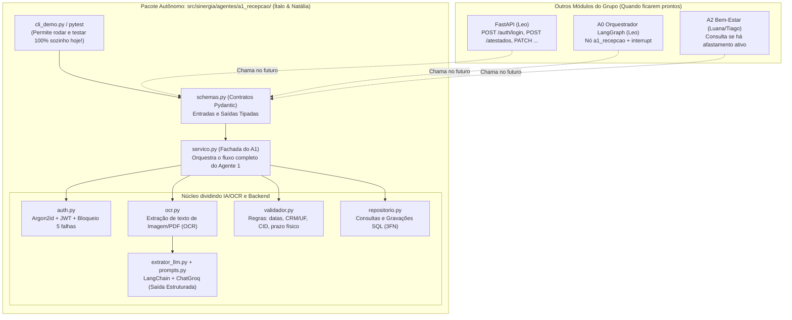
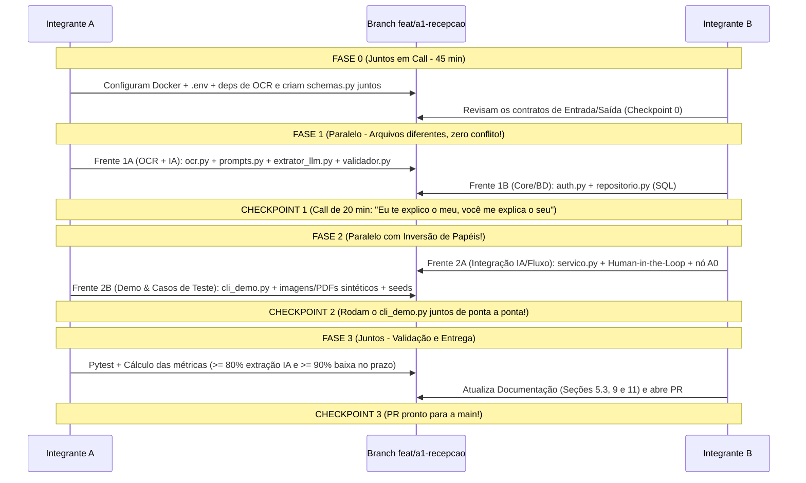

# Plano de Desenvolvimento do Agente 1 (`A1 — Recepção e Processamento`)
**Dupla responsável:** Ítalo & Natália  
**Escopo no repositório:** [`src/sinergia/agentes/a1_recepcao/`](../src/sinergia/agentes/a1_recepcao/__init__.py)  
**Branch oficial:** `feat/a1-recepcao` ([`CONTRIBUTING.md`](../CONTRIBUTING.md))

---

## 1. Visão Geral do Contexto Levantado

Após a leitura integral de `docs/Documentação - SinergIA (v2).docx.pdf` (35 páginas), da especificação técnica ([`Sinergia_Arquitetura_e_Especificacao.pdf`](./Sinergia_Arquitetura_e_Especificacao.pdf)), do schema físico do banco ([`001_schema_inicial.sql`](../db/schema/001_schema_inicial.sql)), dos materiais dos mentores em `docs/contexto-projeto-residencia-eldorado/` e das fontes do NotebookLM (`78543267-d05f-4a7d-af29-71c5980a1a2a`), aqui está o mapeamento completo do **Agente 1 (A1)** na solução **SinergIA**:

> [!IMPORTANT]
> **O Papel Estratégico do A1 na Solução (Seções 4, 5.2 e 5.3 de `Documentação - SinergIA (v2).docx.pdf`)**
> Embora o **A2 (Bem-Estar)** seja o produto central voltado ao colaborador, o **A1 é o alicerce de identidade, dados de afastamento e segurança (LGPD)** de todo o ecossistema:
> 1. **Princípio "Uma identidade, um cadastro" (Pág. 7 e 17):** O A1 autentica o colaborador (`POST /auth/login`) e resolve `id_usuario` $\rightarrow$ `id_colaborador` (chave primária de todas as 48 tabelas). Nome, matrícula, cargo e setor vêm do login e **jamais são digitados novamente**.
> 2. **Recepção, OCR, Extração Estruturada e Human in the Loop (Págs. 15–19):** O A1 recebe o arquivo do atestado (`POST /atestados`), guarda-o em armazenamento privado (gravando apenas `arquivo_uri` no banco), extrai o texto via **OCR** e usa o LLM (`ChatGroq` via LangChain) com **saída estruturada** para extrair os campos. Se a leitura não for confiável, pede nova foto; se for confiável, valida conselho (`CRM`, `CRO`, `CRP`...), `UF` e `CID`, e pausa o fluxo (`interrupt` do LangGraph com checkpoint por `thread_id`) para confirmação humana (`PATCH /atestados/{id}/confirmacao`).
> 3. **Regra de Expiração 24 h / 72 h e Baixa Física (Págs. 15, 18, 33 e 34):**
>    - Se o colaborador não responder à confirmação em **24 h**, o A0 envia um lembrete; após **72 h sem resposta**, o atestado segue para conferência manual do RH.
>    - Confirmado o atestado (`origem_dados = 'IA'` se sem alterações, ou `'MANUAL'` se corrigido), calcula-se o `prazo_entrega_fisica` (**padrão: 2 dias úteis após o retorno ao trabalho**). Quando o RH recebe o papel original (`PATCH /atestados/{id}/baixa-fisica`), grava `recebido_fisico_em` e `recebido_fisico_por` juntos.
> 4. **Gatilho Direto para A2 e A3 (Págs. 8, 17 e 20):** O atestado `CONFIRMADO` faz o **A2 suspender imediatamente os lembretes** durante o afastamento e reagendá-los para o dia do retorno, além de alimentar as rotinas diárias do **A3** (A3.1 ponto durante afastamento, A3.2 epidemiologia por CID e A3.5 atestado físico vencido sem baixa).

### O que o A1 toca no Banco de Dados ([`001_schema_inicial.sql`](../db/schema/001_schema_inicial.sql))
| Schema | Tabelas Operadas pelo A1 | Operação Principal |
| :--- | :--- | :--- |
| **`cadastro`** | `uf`, `municipio`, `area`, `setor`, `cargo`, `colaborador`, `usuario` | Consulta de perfil/identidade, validação de senha (`Argon2id`) e vínculo `id_usuario` $\rightarrow$ `id_colaborador`. |
| **`afastamento`** | `conselho_profissional`, `profissional_saude`, `cid`, `atestado` | Validação/cadastro do profissional de saúde e CID; inserção e atualização do atestado (`PENDENTE` $\rightarrow$ `CONFIRMADO` com `origem_dados` `'IA'` ou `'MANUAL'`); cálculo de `prazo_entrega_fisica` (2 dias úteis após retorno) e baixa física pelo RH (`recebido_fisico_em`, `recebido_fisico_por`). |
| **`orquestracao`** | `log_acesso`, `execucao_agente` | Registro imutável (somente `INSERT`) de eventos de login (`LOGIN`, `LOGOUT`, `FALHA_LOGIN`, `BLOQUEIO`, `TOKEN_RENOVADO`) e telemetria de execução do nó do A1 (tokens, latência, modelo, status). |

### Metas e Entregáveis Obrigatórios do A1 em `Documentação - SinergIA (v2).docx.pdf`
1. **Métrica 1 (Seção 10, pág. 32):** $\ge 80\%$ dos atestados extraídos sem correção manual (`origem_dados = 'IA'`).
2. **Métrica 2 (Seção 10, pág. 32):** $\ge 90\%$ dos atestados físicos baixados no prazo (`recebido_fisico_em::date <= prazo_entrega_fisica`).
3. **Cenários Obrigatórios de Validação do A1 (Seção 11, pág. 33):**
   - *Cenário A1.1:* Envio de atestado com confirmação pelo colaborador (`origem_dados = 'IA'`), correção manual (`origem_dados = 'MANUAL'`) e **expiração de 24 h / 72 h sem resposta**, com **suspensão dos lembretes do A2** durante o afastamento.
   - *Cenário A1.2:* Entrega e baixa do atestado físico **no prazo** e **com prazo vencido** (integrado à regra do alerta A3.5).
4. **Trechos Destacados em Amarelo no PDF v2 que o trabalho da dupla vai preencher:**
   - **Seção 5.3 (pág. 19):** `[Anexar o prompt completo de extração, disponível no repositório (agentes/a1_recepcao/).]`
   - **Seção 9 (pág. 31):** `[Detalhar testes unitários e de integração executados.]` (detalhando os testes do A1).
   - **Seção 11 (pág. 33):** `[A preencher pelo grupo: inserir capturas de tela, logs ou exemplos de execução dos cenários acima.]` e `[A preencher pelo grupo: comparar os resultados obtidos com as metas da seção 10.]`.

---

## 2. Como Garantir Independência Sem Fugir da Arquitetura

Nas *Guiding Questions* dos mentores (`Challenge2_Material_Apoio_1.pdf`), uma pergunta-chave é: **"O que são contratos entre agentes? Existe algum schema de contrato?"**.

Se vocês esperarem o **Leo** construir a API FastAPI (`src/sinergia/api/`) e o Orquestrador LangGraph (`src/sinergia/orquestrador/`), ou o **Tiago** popular o banco, o trabalho de vocês ficará travado. Além disso, pelo [`.github/CODEOWNERS`](../.github/CODEOWNERS), vocês devem trabalhar dentro de `src/sinergia/agentes/a1_recepcao/` para não gerar conflitos de merge com o restante do grupo.

A solução é desenvolver o **A1 como um módulo autossuficiente orientado a Contratos (Pydantic)** com um **Adaptador Plug-and-Play**:



### Os 4 Pilares da Independência do A1:
1. **Contrato Único (`schemas.py`):** O A1 recebe e devolve objetos Pydantic bem definidos. Não importa se quem chamou o A1 foi o script de terminal de vocês hoje (`cli_demo.py`) ou o LangGraph/FastAPI do Leo semana que vem.
2. **Duplo Modo de OCR + LLM (Real vs. Mock):** O `ocr.py` extrai o texto bruto da imagem/PDF do atestado e o `extrator_llm.py` usa o `ChatGroq` quando a `GROQ_API_KEY` está configurada, mas ambos aceitam mocks nos testes automatizados para vocês testarem regras de negócio em milissegundos e sem gastar cota de API.
3. **Seed de Dados Local de Teste:** Dentro dos testes/demo do A1, vocês terão um pequeno script utilitário que insere 2 colaboradores, 3 CIDs, 2 conselhos (`CRM`, `CRO`) e 1 usuário RH no PostgreSQL local (Docker), sem depender de `db/seeds/` estar pronto.
4. **Simulador Interativo Próprio (`cli_demo.py`):** Um script de linha de comando que simula o chat/fluxo completo do A1 (Login $\rightarrow$ Upload de Imagem/PDF $\rightarrow$ OCR + Extração IA $\rightarrow$ Pausa para Confirmação/Correção $\rightarrow$ Baixa pelo RH). Assim vocês já têm **um agente funcional demonstrável** para as mentorias!

---

## 3. Estrutura de Arquivos Proposta (Zero Conflito de Git)

Para que você e a Natália consigam programar ao mesmo tempo na branch `feat/a1-recepcao` sem sobrescrever o código um do outro, cada responsabilidade fica em um arquivo separado dentro de `src/sinergia/agentes/a1_recepcao/`:

```text
src/sinergia/agentes/a1_recepcao/
├── __init__.py          # Exporta as funções principais e schemas para o resto do sistema
├── schemas.py           # Contratos Pydantic (Login, Extração LLM, Confirmação, Baixa, Estado A0)
├── ocr.py               # Leitura de imagem (.png/.jpg) e PDF de atestados via OCR para texto bruto
├── prompts.py           # System Prompt oficial de extração e instruções de guardrail
├── extrator_llm.py      # Cadeia LangChain + ChatGroq com .with_structured_output()
├── validador.py         # Regras de negócio puras (datas, CRM/UF, CID opcional, prazo em dias úteis)
├── auth.py              # Hash Argon2id, geração/leitura de JWT e regra de bloqueio (5 falhas/15 min)
├── repositorio.py       # Operações SQL nos schemas cadastro, afastamento e orquestracao
├── servico.py           # Fluxo completo do A1 + adaptador para o grafo LangGraph do A0
└── cli_demo.py          # Simulador interativo no terminal para testar e apresentar o A1 isolado

tests/a1_recepcao/
├── conftest.py          # Fixtures de banco/mock e geração de imagens/PDFs sintéticos de atestados
├── test_ia_validador.py # Testes unitários do OCR, extrator LLM e regras de validação
└── test_auth_fluxo.py   # Testes de login, bloqueio, persistência e fluxo Human-in-the-Loop
```

---

## 4. Fluxo de Trabalho e Comunicação da Dupla (Ítalo & Natália)

Como o objetivo da Residência é que **ambos aprendam e apliquem** tanto a parte de IA Generativa/OCR quanto a parte de Arquitetura/Dados, sugerimos a dinâmica **"Contrato Juntos $\rightarrow$ Execução Paralela $\rightarrow$ Troca Explicada (Cross-Review)"**:



> [!TIP]
> **Por que inverter os papéis entre a Fase 1 e a Fase 2?**
> Na **Fase 1**, um integrante foca em **OCR/IA/LangChain/Regras** (`ocr.py`, `prompts.py`, `extrator_llm.py`, `validador.py`) e o outro em **Segurança/Banco** (`auth.py`, `repositorio.py`). Na **Fase 2**, quem fez Segurança/Banco assume o `servico.py` (conectando o OCR + LLM ao fluxo *Human-in-the-Loop* e ao estado do LangGraph), enquanto quem fez o OCR/LLM constrói os cenários de banco, seeds, gerador de imagens de atestados e o simulador `cli_demo.py`. Assim, **os dois colocam a mão na massa em todas as tecnologias!**

### Regras Simples de Git para a Dupla na branch `feat/a1-recepcao`:
1. Antes de começar a codar no dia: `git checkout feat/a1-recepcao && git pull`
2. Como na Fase 1 e na Fase 2 cada um edita **arquivos diferentes**, vocês podem dar `git commit` e `git push` na mesma branch `feat/a1-recepcao` sem conflito!
3. Sempre avisar no WhatsApp/Discord da dupla quando subir um commit: *"Subi o `validador.py`, dá um `git pull` aí!"*.

---

## 5. Estrutura Detalhada de Tasks e Checkpoints

---

### 🏁 FASE 0: Setup do Ambiente e Contrato do Agente (Juntos)
**Objetivo:** Deixar o banco PostgreSQL e a biblioteca de OCR rodando nas duas máquinas e definir o "contrato" (`schemas.py`) que servirá de ponte entre todas as tarefas.

- [ ] **Task 0.1 — Setup Local, Dependências de OCR e Banco de Dados:**
  - Copiar `.env.example` para `.env` e configurar `GROQ_API_KEY` e `JWT_SECRET`.
  - Subir o container PostgreSQL 16 + pgvector: `docker compose up -d`.
  - Aplicar o schema inicial: `docker compose exec -T db psql -U sinergia -d sinergia < db/schema/001_schema_inicial.sql`.
  - Definir e instalar a biblioteca de OCR/PDF no ambiente (ex: `pypdf`/`pymupdf` para PDFs + `rapidocr-onnxruntime` ou `easyocr`/`pytesseract` + `Pillow`, que rodam localmente sem precisar de binários externos complexos no Windows) e instalar o pacote: `pip install -e ".[dev]"`.
- [ ] **Task 0.2 — Criação da Branch e Definição do `schemas.py` (Em Dupla):**
  - Criar e publicar a branch `feat/a1-recepcao`.
  - Implementar `src/sinergia/agentes/a1_recepcao/schemas.py` contendo os modelos Pydantic:
    - `CredenciaisLogin` (`login`, `senha`, `ip_origem`) e `SessaoUsuario` (`id_usuario`, `id_colaborador`, `nome`, `matricula`, `id_cargo`, `id_setor`, `perfil`, `jornada_inicio`, `jornada_fim`, `token_jwt`).
    - `ResultadoOCR` (`arquivo_uri`, `texto_extraido`, `confianca_media_ocr: float | None`, `sucesso_leitura: bool`).
    - `AtestadoExtraidoLLM` (schema exato para o `.with_structured_output()` do LangChain):
      - `leitura_confiavel: bool`
      - `motivo_inconfiavel: str | None`
      - `data_emissao: date | None`
      - `inicio_afastamento: datetime | None`
      - `fim_afastamento: datetime | None`
      - `conselho_sigla: str | None` (ex: `'CRM'`, `'CRO'`, `'CRP'`)
      - `numero_registro_profissional: str | None`
      - `uf_registro_profissional: str | None` (2 letras)
      - `nome_profissional: str | None`
      - `codigo_cid: str | None` (opcional!)
      - `municipio_nome: str | None`
      - `uf_municipio: str | None`
    - `ConfirmacaoColaboradorInput` (`id_atestado`, `id_colaborador`, `confirmado: bool`, `dados_corrigidos: AtestadoExtraidoLLM | None`).
    - `BaixaFisicaInput` (`id_atestado`, `id_usuario_rh`).

> **✅ CHECKPOINT 0:** O PostgreSQL está rodando com as 48 tabelas criadas nas duas máquinas, as dependências de OCR estão instaladas e o arquivo `schemas.py` está commitado na branch `feat/a1-recepcao` sem erros de importação.

---

### 🧠 FASE 1: Construção dos Motores do A1 (Trabalho Paralelo)

#### 🔹 Frente 1A: Módulo de OCR, Inteligência de Extração (LLM) e Regras de Negócio
*Arquivos: `ocr.py`, `prompts.py`, `extrator_llm.py`, `validador.py`*

- [ ] **Task 1A.1 — Pipeline de OCR de Imagens e PDFs (`ocr.py`):**
  - Implementar `extrair_texto_documento(caminho_arquivo: str | Path) -> ResultadoOCR`:
    - Suportar imagens (`.png`, `.jpg`, `.jpeg`) via OCR e documentos `.pdf` (extraindo camada de texto ou convertendo página para imagem + OCR).
    - Calcular a confiança média do OCR e sinalizar `sucesso_leitura = False` quando a imagem estiver em branco, corrompida ou abaixo do limiar mínimo de legibilidade.
    - Salvar o arquivo recebido em pasta local privada (ex: `.storage/atestados/`) e gerar a `arquivo_uri` (respeitando o guardrail da LGPD de não expor o arquivo em URL pública).
- [ ] **Task 1A.2 — Engenharia de Prompt do A1 (`prompts.py`):**
  - Escrever o `SYSTEM_PROMPT_EXTRACAO_ATESTADO` seguindo todas as diretrizes e guardrails da Seção 5.3 da especificação:
    - Extrair exclusivamente os campos previstos no schema estruturado a partir do texto bruto do OCR.
    - Marcar `leitura_confiavel = False` se o documento não for um atestado/declaração médica, se o OCR estiver truncado/ilegível ou se faltar data/registro médico essencial.
    - **Jamais inventar ("adivinhar") campos ilegíveis** (Regra R08).
    - **Não solicitar nem exigir dados que já vêm do login** (nome, matrícula, cargo, setor).
    - Respeitar que o `codigo_cid` é opcional (só extrair se constar expressamente no documento).
- [ ] **Task 1A.3 — Extrator com Saída Estruturada (`extrator_llm.py`):**
  - Implementar a função `extrair_dados_atestado(texto_ocr: str, llm=None) -> tuple[AtestadoExtraidoLLM, MetricasExecucao]` usando `ChatGroq` + `.with_structured_output(AtestadoExtraidoLLM)`.
  - Capturar métricas da chamada (`modelo_llm`, `tokens_entrada`, `tokens_saida`, `latencia_ms`) para alimentar a tabela `orquestracao.execucao_agente`.
  - Permitir injeção de um `llm` fake/mock para testes offline.
- [ ] **Task 1A.4 — Validador de Regras de Negócio (`validador.py`):**
  - Implementar funções puras de validação sobre `AtestadoExtraidoLLM`:
    - Validar `fim_afastamento >= inicio_afastamento` (constraint do banco) e coerência da `data_emissao`.
    - Normalizar e validar sigla do conselho (`CRM`, `CRO`, `CRP`), sigla de `UF` (2 caracteres maiúsculos) e formato do `codigo_cid` (quando informado).
    - Implementar `calcular_prazo_entrega_fisica(fim_afastamento: datetime, dias_uteis: int = 2) -> date` (pula sábados e domingos a partir do retorno ao trabalho, conforme seção 5.3 da documentação).

#### 🔸 Frente 1B: Identidade, Segurança (LGPD) e Repositório SQL
*Arquivos: `auth.py`, `repositorio.py`*

- [ ] **Task 1B.1 — Autenticação Argon2id, JWT e Anti-Brute-Force (`auth.py`):**
  - Implementar `gerar_hash_senha(senha: str) -> str` e `verificar_senha(senha: str, senha_hash: str) -> bool` usando `argon2-cffi` (`PasswordHasher`).
  - Implementar `emitir_token_jwt(sessao: SessaoUsuario) -> str` e `decodificar_token_jwt(token: str) -> dict` usando `pyjwt` com expiração curta.
  - Implementar a verificação de bloqueio: consultar se o login possui $\ge 5$ eventos `'FALHA_LOGIN'` nos últimos 15 minutos sem um `'LOGIN'` posterior; se sim, registrar `'BLOQUEIO'` e negar o acesso por 15 min.
- [ ] **Task 1B.2 — Repositório de Dados do A1 (`repositorio.py`):**
  - Implementar métodos claros de acesso ao PostgreSQL (usando `sqlalchemy` / `psycopg`):
    - `buscar_usuario_por_login(login)` (fazendo `JOIN` entre `cadastro.usuario` e `cadastro.colaborador` para já trazer `id_colaborador`, `id_cargo`, `id_setor`, `jornada_inicio`, `jornada_fim`).
    - `registrar_log_acesso(id_usuario, login_informado, evento, ip_origem)` em `orquestracao.log_acesso`.
    - `obter_ou_criar_profissional_saude(sigla_conselho, numero_registro, sigla_uf, nome)` em `afastamento.profissional_saude`.
    - `validar_existencia_cid(codigo_cid)` em `afastamento.cid` e `buscar_id_municipio(nome, sigla_uf)` em `cadastro.municipio`.
    - `criar_atestado_pendente(...)`, `confirmar_atestado(id_atestado, dados, origem_dados, prazo_entrega_fisica)` e `registrar_baixa_fisica_atestado(id_atestado, id_usuario_rh)` em `afastamento.atestado`.
    - `listar_atestados_pendentes_expirados(horas_limite: int)` e `listar_atestados_fisicos_vencidos()` (suporte às regras da pág. 15, 18 e 33 de `docs/Documentação - SinergIA (v2).docx.pdf`: lembrete após 24 h sem confirmação, escalonamento para revisão manual do RH após 72 h sem resposta e alerta de atestado físico vencido).
    - `consultar_afastamento_confirmado_ativo(id_colaborador, data_referencia)` (usado pelo A2 para suspender lembretes!).
    - `registrar_execucao_agente(...)` em `orquestracao.execucao_agente`.

> **✅ CHECKPOINT 1 (Reunião de 20 min da Dupla):**
> 1. **Cross-Review Didático:** Quem fez a Frente 1A mostra como o `ChatGroq` extrai o Pydantic estruturado do atestado; quem fez a Frente 1B mostra como o Argon2id/JWT e as queries SQL funcionam.
> 2. **Teste Rápido:** Rodar o extrator em 1 texto de atestado de exemplo e testar 1 login + inserção no banco local.

---

### 🔄 FASE 2: Fluxo Human-in-the-Loop, Desacoplamento e Simulador (Paralelo com Inversão)

*(Sugestão: Aqui vocês invertem as frentes para que ambos pratiquem tanto IA/Fluxo quanto Banco/Testes!)*

#### 🔹 Frente 2A: Orquestração Interna do Serviço A1 e Ponte com A0/A2
*Arquivo: `servico.py`, `__init__.py`*

- [ ] **Task 2A.1 — Serviço Completo de Recepção e Confirmação (`servico.py`):**
  - Unir `auth`, `ocr`, `extrator_llm`, `validador` e `repositorio` nos 5 fluxos de negócio do A1:
    1. **Fluxo de Login (`login`):** Verifica bloqueio $\rightarrow$ valida Argon2id $\rightarrow$ grava `log_acesso` $\rightarrow$ retorna `SessaoUsuario` com `id_colaborador` e JWT.
    2. **Fluxo de Upload, OCR e Extração (`receber_atestado`):** Salva o arquivo em diretório privado (`arquivo_uri`) $\rightarrow$ executa `extrair_texto_documento` (`ocr.py`) $\rightarrow$ chama `extrair_dados_atestado` (`extrator_llm.py`) $\rightarrow$ se `sucesso_leitura == False` ou `leitura_confiavel == False`, retorna pedido de nova foto; se `True`, valida dados, grava rascunho `PENDENTE` e retorna os dados extraídos para confirmação humana (*Human in the Loop*).
    3. **Fluxo de Confirmação ou Correção (`confirmar_atestado_colaborador`):**
       - Se o colaborador confirmar sem alterar: muda status para `CONFIRMADO`, define `origem_dados = 'IA'` e grava `prazo_entrega_fisica`.
       - Se o colaborador corrigir algum campo: aplica as correções, valida, muda status para `CONFIRMADO`, define `origem_dados = 'MANUAL'` e grava `prazo_entrega_fisica`.
       - Retorna a mensagem final orientando a entrega do atestado físico ao RH até `prazo_entrega_fisica`.
    4. **Fluxo de Baixa Física pelo RH (`dar_baixa_atestado_fisico`):** Verifica se `perfil == 'RH'` (Guardrail de segurança!) $\rightarrow$ preenche `recebido_fisico_em` e `recebido_fisico_por` $\rightarrow$ retorna confirmação para notificar o colaborador.
    5. **Fluxo de Verificação de Prazos e Expiração (`verificar_pendencias_atestado`):** Identifica atestados `PENDENTE` há $\ge 24\text{ h}$ (para lembrete do A0) e $\ge 72\text{ h}$ (para revisão manual do RH), além de atestados `CONFIRMADO` com `prazo_entrega_fisica` vencido e `recebido_fisico_em IS NULL` (para alerta do A3.5 ao RH e lembrete ao colaborador, conforme páginas 15, 18 e 33 da documentação).
- [ ] **Task 2A.2 — Adaptador Plug-and-Play para o A0 (`executar_no_a1_langgraph`):**
  - Criar uma função compatível com o estado do grafo do A0 descrito na página 15 da documentação (`thread_id`, `id_usuario`, `id_colaborador`, `perfil`, `intencao`, `contexto_recuperado`, `resposta`), facilitando a futura integração com o código do Leo.

#### 🔸 Frente 2B: Atestados Sintéticos (Imagens/PDFs), Seed de Teste e Simulador Standalone
*Arquivos: `cli_demo.py`, `tests/a1_recepcao/conftest.py`*

- [ ] **Task 2B.1 — Kit de Atestados Sintéticos (Imagens/PDFs) e Seed Autônomo:**
  - Criar um seed leve (idempotente, com `ON CONFLICT DO NOTHING`) que garanta no banco local de desenvolvimento: UFs (`SP`, `RJ`, `MG`), municípios, conselhos (`CRM`, `CRO`, `CRP`), CIDs (`M54.5` Dorsalgia, `J06.9` IVAS, `F43.0` Reação ao estresse), 1 colaborador de teste e 1 analista de RH de teste.
  - Criar um gerador/conjunto de **5 a 10 atestados médicos sintéticos em imagem (`.png`/`.jpg`) e `.pdf`** (usando `Pillow`/`reportlab` para renderizar atestados reais de teste):
    - Imagens/PDFs nítidos e legíveis (com e sem CID).
    - Imagem com ruído/borrão leve (para demonstrar a correção manual pelo colaborador no *Human in the Loop*).
    - Imagem borrada/cortada/ilegível (para demonstrar o OCR + A1 rejeitando a leitura e pedindo nova foto).
- [ ] **Task 2B.2 — Simulador Interativo de Terminal (`cli_demo.py`):**
  - Criar um menu interativo em Python (`python -m sinergia.agentes.a1_recepcao.cli_demo`) que permita demonstrar ao vivo todos os cenários do A1 sem precisar de front-end ou de outros agentes:
    - Opção 1: Fazer Login como Colaborador (ou testar 5 senhas erradas para ver o bloqueio de 15 min).
    - Opção 2: Enviar Arquivo de Atestado (`.png`/`.jpg`/`.pdf`) $\rightarrow$ ver o texto lido pelo OCR + o JSON extraído pela IA em tempo real $\rightarrow$ responder `[S] Confirmar` ou `[N] Corrigir dados` (*Human in the Loop*).
    - Opção 3: Fazer Login como RH $\rightarrow$ listar atestados aguardando entrega física $\rightarrow$ dar baixa física.
    - Opção 4: Simular verificação de prazos (24h/72h sem confirmação e atestado físico vencido) e consultar se o colaborador está afastado (mostrando o dado que o A2 consome).

> **✅ CHECKPOINT 2 (Reunião Prática de 30 min da Dupla):**
> Vocês rodam juntos o `python -m sinergia.agentes.a1_recepcao.cli_demo` conectando no PostgreSQL e na API da Groq. Nesse ponto, o **Agente 1 já está 100% vivo, funcional e demonstrável para os mentores!**

---

### 📊 FASE 3: Validação de Métricas, Testes Automatizados e Documentação (Juntos)

- [ ] **Task 3.1 — Suite de Testes Automatizados (`pytest`):**
  - Implementar `tests/a1_recepcao/test_ia_validador.py` e `tests/a1_recepcao/test_auth_fluxo.py` cobrindo todos os cenários da **Seção 11 (pág. 33)** de `docs/Documentação - SinergIA (v2).docx.pdf`:
    - Hash Argon2id e bloqueio após 5 falhas consecutivas de login por 15 min.
    - Rejeição de foto ilegível (`leitura_confiavel = False`).
    - Confirmação com `origem_dados = 'IA'` vs. correção com `origem_dados = 'MANUAL'`.
    - Regra de expiração de confirmação: lembrete em 24 h e revisão manual pelo RH em 72 h para atestados `PENDENTE`.
    - Cálculo de `prazo_entrega_fisica` (2 dias úteis após retorno), baixa física exclusiva pelo perfil `RH`, detecção de atestado físico vencido e suspensão de lembretes durante afastamento ativo.
- [ ] **Task 3.2 — Script de Avaliação das Métricas de Sucesso do A1 (Seção 10, pág. 32 e Seção 11, pág. 33):**
  - Rodar os atestados sintéticos válidos no extrator do LLM, comparar automaticamente os campos extraídos com o gabarito esperado e calcular as métricas oficiais da Seção 10 (pág. 32):
    $$\text{Taxa de Extração Sem Correção Manual} = \frac{\text{Atestados extraídos com 100\% de exatidão nos campos}}{\text{Total de atestados legíveis testados}} \ge 80\%$$
    $$\text{Taxa de Baixa Física no Prazo (Simulação)} = \frac{\text{Atestados físicos baixados até }\texttt{prazo\_entrega\_fisica}}{\text{Total de atestados confirmados no lote de teste}} \ge 90\%$$
  - Salvar o relatório/print do terminal como evidência para a Seção 11 da Documentação.
- [ ] **Task 3.3 — Preenchimento dos Campos em Amarelo da Documentação e Pull Request:**
  - **Seção 5.3 (pág. 19):** Substituir `[Anexar o prompt completo de extração, disponível no repositório (agentes/a1_recepcao/).]` pelo System Prompt final do A1.
  - **Seção 9 (pág. 31):** Preencher a IDE utilizada, detalhar os testes unitários/integração do A1 e incluir a linha `A1 — Recepção | Ítalo e Natália` na tabela de *Frente / Responsável*.
  - **Seção 11 (pág. 33):** Preencher `Evidências`, `Resultados` e `Validação da Hipótese` dos cenários do A1.
  - Abrir o Pull Request da branch `feat/a1-recepcao` para a `main` preenchendo o checklist de [`.github/pull_request_template.md`](../.github/pull_request_template.md).

> **✅ CHECKPOINT 3 (Definition of Done):** Todos os testes passando no `pytest`, metas da Seção 10 ($\ge 80\%$ e $\ge 90\%$) validadas com evidências, trechos em amarelo das páginas 19, 31 e 33 preenchidos e Pull Request aberto!
