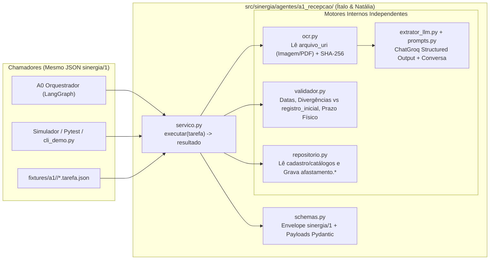
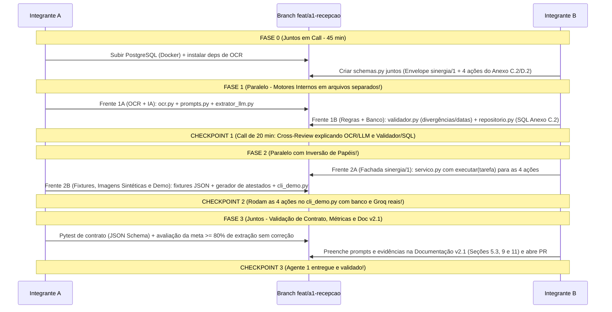

# Plano de Desenvolvimento do Agente 1 (`A1 — Recepção e Processamento`) — Alinhado à v2.1
**Dupla responsável:** Ítalo & Natália  
**Escopo no repositório:** [`src/sinergia/agentes/a1_recepcao/`](../src/sinergia/agentes/a1_recepcao/__init__.py)  
**Branch oficial:** `feat/a1-recepcao` ([`CONTRIBUTING.md`](../CONTRIBUTING.md))  
**Documento-base:** `docs/Documentação - SinergIA v2.1.docx` (Seção 5.3 e Anexos A, B, C.2, D.2, E.2, F, G e H)

---

## 1. O que Mudou na Documentação v2.1 para o Agente 1? (Resumo para a Dupla)

A revisão **v2.1** (alinhada aos contratos v0.7 do grupo) trouxe decisões importantes que deixaram o escopo do **Agente 1 (A1)** muito mais limpo, focado e 100% independente:

> [!IMPORTANT]
> **As 5 Grandes Atualizações da v2.1 que Impactam Diretamente o A1 (Anexo H e Seção 5.3):**
> 1. **O A1 NÃO faz mais Login nem grava em `orquestracao` (Seção 5.2, 5.3 e Anexo G):**
>    - Na v2.0, o login estava no A1. **Na v2.1 ficou decidido que o Login (`Argon2id`, `JWT`, bloqueio de 5 falhas e `log_acesso`) é responsabilidade exclusiva do A0 (Orquestrador).**
>    - O A1 já recebe na tarefa o `id_colaborador` autenticado e o `registro_inicial` (com nome, matrícula, área, setor, cargo, jornada, município, UF, início e dias informados pelo colaborador).
>    - O A1 também **não grava diretamente nas tabelas do schema `orquestracao`** (Anexo C.2): ele devolve os metadados no bloco `decisao`, `saidas` e `eventos` do JSON de resposta, e o A0 é quem registra em `orquestracao.execucao_agente` e entrega as mensagens!
> 2. **Comunicação em Estrela com Contrato Padrão `sinergia/1` (Anexo A):**
>    - Os agentes não se chamam entre si. Cada agente expõe **uma única função de entrada**: `executar(tarefa) -> resultado`.
>    - Toda comunicação entre A0 e A1 usa o envelope JSON do protocolo **`sinergia/1`** (`tipo: "TAREFA"` $\rightarrow$ `tipo: "RESULTADO"`), garantindo **idempotência por `id_mensagem`** (se a mesma `id_mensagem` chegar duas vezes, o A1 devolve o mesmo resultado sem duplicar registro no banco).
> 3. **As 4 Ações Oficiais do A1 no Catálogo (Anexos A, C.2 e D.2):**
>    - `a1.conversar`: Quando o colaborador envia mensagem sobre atestado sem anexar arquivo ou com dado faltando $\rightarrow$ devolve `estado_proposto = "NOVO"`, `payload.faltando` e a pergunta em `saidas`.
>    - `a1.processar_documento`: Quando chega o arquivo (`arquivo_uri`, `mime`, `sha256`) $\rightarrow$ lê o arquivo do armazenamento privado via OCR + LLM estruturado, compara com o `registro_inicial` (gerando `payload.divergencias`), grava o atestado `PENDENTE` e devolve `status = "PRECISA_HUMANO"`, `estado_proposto = "RECEBIDO"` e o evento `atestado.extraido`.
>    - `a1.confirmar`: Quando o colaborador confirma ou corrige os dados $\rightarrow$ valida regras (`fim >= inicio`, conselho/UF, colaborador ativo no período); se válido, muda o atestado para `CONFIRMADO` (`origem = "IA"` ou `"MANUAL"`), calcula `prazo_entrega_fisica` (2 dias úteis após o retorno) e emite o evento `atestado.registrado`; se inválido, devolve `estado_proposto = "NOVO"` e emite `atestado.invalido`.
>    - `a1.registrar_baixa_fisica`: Quando o RH registra o recebimento do original em papel (`id_atestado`, `recebido_fisico_por`, `recebido_fisico_em`) $\rightarrow$ grava no banco, devolve mensagem de confirmação ao colaborador e emite `atestado.baixa_registrada`.
> 4. **Política de CID em Aberto (Seção 5.3 e Anexo G):**
>    - O grupo marcou como pendência decidir se no MVP vai **(a) extrair e validar o CID** ou **(b) não extrair (deixar `cid: null`)**.
>    - **Solução prática para a dupla:** vamos controlar isso por uma variável de configuração (`POLITICA_EXTRAIR_CID=true/false`). Assim, o código de vocês já suporta os dois cenários sem precisar refatorar nada depois!
> 5. **Plano Oficial de Construção em Caixas-Pretas e Fixtures (Anexo F):**
>    - A v2.1 adotou exatamente a estratégia de desenvolvimento independente usando arquivos de exemplo (`fixtures/a1/<acao>/<nome>.tarefa.json` e `.esperado.json`) validados contra o contrato Pydantic/JSON Schema.

---

## 2. Acesso ao Banco de Dados pelo A1 (Anexo C.2 da v2.1)

Conforme a tabela oficial do **Anexo C.2**, os dados de `cadastro` e os catálogos (`conselho_profissional`, `cid`) são **dados de origem** (carregados pela empresa e **somente lidos** pelo A1). O A1 só grava em duas tabelas do schema `afastamento`:

| Tabela / Recurso | Lê | Grava | Para quê | Quem grava originalmente |
| :--- | :---: | :---: | :--- | :--- |
| `cadastro.colaborador`, `cargo`, `setor` | **Sim** | — | Conferir nome e se o colaborador estava ativo no período do atestado | Empresa (Seed) |
| `afastamento.conselho_profissional` | **Sim** | — | Validar sigla do conselho (`CRM`, `CRO`, `CRP`) e `UF` | Empresa (Seed) |
| `afastamento.cid` *(conforme política de CID)* | **Sim** | — | Validar se o código CID extraído existe no catálogo | Empresa (Seed) |
| `afastamento.profissional_saude` | **Sim** | **Sim** | Consultar ou cadastrar o profissional (conselho, número e UF) | **A1** |
| `afastamento.atestado` | **Sim** | **Sim** | Gravar o atestado (`PENDENTE` $\rightarrow$ `CONFIRMADO`, período, emissão, `origem_dados`, `arquivo_uri`, `prazo_entrega_fisica`), consultar anteriores/duplicados e registrar a baixa física (`recebido_fisico_em`, `recebido_fisico_por`) | **A1** |
| Armazenamento privado de arquivos | **Sim** | — | Abrir a imagem (`.png`/`.jpg`) ou `.pdf` pelo `arquivo_uri` enviado pelo A0 | A0 |
| `orquestracao.*` (todas) | — | — | **Não acessa diretamente:** `id_colaborador` e `registro_inicial` chegam na `TAREFA`, e a auditoria volta no bloco `decisao` do `RESULTADO` | A0 |

---

## 3. Arquitetura Interna do A1 Orientada ao Protocolo `sinergia/1`



---

## 4. Estrutura de Arquivos Proposta (Zero Conflito de Git)

Como o login saiu do A1 (foi para o A0), o arquivo `auth.py` não é mais necessário dentro de `a1_recepcao/`. Em seu lugar, entra a estrutura alinhada ao **Anexo C.2, D.2 e F**:

```text
src/sinergia/agentes/a1_recepcao/
├── __init__.py          # Exporta a função oficial executar(tarefa) e os schemas do A1
├── schemas.py           # Envelope sinergia/1 (TAREFA/RESULTADO) e Payloads das 4 ações do A1
├── ocr.py               # Abertura do arquivo_uri (Imagem/PDF), cálculo/verificação de sha256 e OCR
├── prompts.py           # System Prompts de extração estruturada e de conversa (a1.conversar)
├── extrator_llm.py      # Cadeia LangChain + ChatGroq (.with_structured_output) e suporte a MockLLM
├── validador.py         # Cruzamento com registro_inicial (divergências), datas, prazo útil e regras E.2
├── repositorio.py       # Queries SQL estritas do Anexo C.2 (lê cadastro/cid/conselho, grava atestado/profissional)
├── servico.py           # Implementa executar(tarefa) -> resultado roteando as 4 ações + idempotência
└── cli_demo.py          # Simulador interativo para testar e demonstrar as 4 ações do A1 no terminal

tests/a1_recepcao/
├── fixtures/            # Exemplos oficiais do Anexo D.2 e F (<acao>/<caso>.tarefa.json e .esperado.json)
├── conftest.py          # Seed local da empresa fictícia + gerador de imagens/PDFs sintéticos de atestados
├── test_contrato_a1.py  # Valida todas as 4 ações contra o JSON Schema do protocolo sinergia/1
└── test_regras_ocr.py   # Testa OCR, divergências, cálculo de prazo físico, idempotência e métricas (>= 80%)
```

---

## 5. Fluxo de Trabalho e Comunicação da Dupla (Ítalo & Natália)

Mantemos a dinâmica **"Contrato Juntos $\rightarrow$ Execução Paralela sem Conflito $\rightarrow$ Cross-Review Explicado"**, ajustada para as 4 ações da v2.1:



---

## 6. Estrutura Detalhada de Tasks e Checkpoints (Baseada na v2.1)

---

### 🏁 FASE 0: Base Comum e Contratos `sinergia/1` (Juntos — Anexo F, Fase 0)
**Objetivo:** Deixar o PostgreSQL e o OCR funcionando nas duas máquinas e congelar os modelos Pydantic do protocolo `sinergia/1` para o A1.

- [ ] **Task 0.1 — Setup Local, Dependências de OCR e Banco de Dados:**
  - Copiar `.env.example` para `.env` e configurar `GROQ_API_KEY` e `POLITICA_EXTRAIR_CID=true`.
  - Subir o container PostgreSQL 16 + pgvector (`docker compose up -d`) e aplicar `db/schema/001_schema_inicial.sql`.
  - Instalar dependências de OCR/PDF (`Pillow`, `pymupdf` ou `pypdf`, `rapidocr-onnxruntime` ou `pytesseract`) e o pacote local (`pip install -e ".[dev]"`).
- [x] **Task 0.2 — Contrato `sinergia/1` do A1 (`schemas.py` e `config.py`):**
  - Implementar os modelos Pydantic seguindo exatamente os **Anexos A, B, C.2 e D.2** da `Documentação - SinergIA v2.1.docx`:
    - **Envelope Base:** `Correlacao`, `ContextoTarefa`, `RegistroInicialCaso` (Anexo B), `SaidaMensagem`, `EventoEmitido`, `DecisaoAgente`, `ErroAgente`, `TarefaA1` e `ResultadoA1`.
    - **Modelo de Extração (`AtestadoExtraido` — Anexo D.2):**
      ```python
      class PeriodoAfastamento(BaseModel):
          inicio: date | None
          fim: date | None

      class ProfissionalExtraido(BaseModel):
          conselho: str | None  # ex: "CRM", "CRO", "CRP"
          numero: str | None
          uf: str | None        # ex: "SP"

      class AtestadoExtraido(BaseModel):
          legibilidade: Literal["ok", "ilegivel"]
          nome_no_documento: str | None = None
          periodo: PeriodoAfastamento
          data_emissao: date | None = None
          profissional: ProfissionalExtraido
          cid: str | None = None
          municipio: str | None = None
      ```
    - **Modelo de Divergência (`DivergenciaCampo` — Anexo D.2):** `campo`, `no_documento`, `informado`.
    - Exportação automática de JSON Schema (`TarefaA1.model_json_schema()`, `ResultadoA1.model_json_schema()`) para os testes de contrato do Anexo F.

> **✅ CHECKPOINT 0:** Banco rodando, dependências de OCR instaladas e `schemas.py` validando os 5 JSONs de exemplo do **Anexo D.2** sem nenhum erro!

---

### 🧠 FASE 1: Construção dos Motores Internos do A1 (Trabalho Paralelo)

#### 🔹 Frente 1A: Módulo de OCR, Prompts e Extração/Conversação com LLM
*Arquivos: `ocr.py`, `prompts.py`, `extrator_llm.py`*

- [ ] **Task 1A.1 — Leitura de Arquivo Privado e OCR (`ocr.py`):**
  - Implementar `processar_arquivo_atestado(arquivo_uri: str, mime: str | None = None, sha256_esperado: str | None = None)`:
    - Ler a imagem (`.png`, `.jpg`) ou `.pdf` a partir do `arquivo_uri` no armazenamento privado.
    - Calcular/conferir o hash `sha256` do arquivo.
    - Executar o OCR para extrair o texto bruto e a confiança média de leitura (sinalizando `legibilidade = "ilegivel"` caso a imagem esteja em branco, corrompida ou ilegível).
- [ ] **Task 1A.2 — Engenharia de Prompts do A1 (`prompts.py`):**
  - `SYSTEM_PROMPT_EXTRACAO_ATESTADO`: Instrui o LLM a extrair os campos de `AtestadoExtraido` a partir do texto do OCR:
    - Nunca adivinhar campos ilegíveis (deixar `null` quando a confiança for $< 0.8$, conforme Anexo E.2).
    - Não pedir dados que já estão no `registro_inicial` do login.
    - Extrair `cid` somente se constar no documento e se `POLITICA_EXTRAIR_CID` estiver ativa.
  - `SYSTEM_PROMPT_CONVERSAR_A1`: Para a ação `a1.conversar`, identificando de forma acolhedora o que falta o colaborador enviar (ex: foto/PDF do atestado) com base em `texto` e `historico_resumo`.
- [ ] **Task 1A.3 — Extrator e Conversador LangChain + Groq (`extrator_llm.py`):**
  - Implementar `extrair_atestado_via_llm(texto_ocr: str, llm=None) -> tuple[AtestadoExtraido, DecisaoAgente]` usando `ChatGroq` + `.with_structured_output(AtestadoExtraido)`.
  - Implementar `analisar_conversa_atestado(texto: str, historico_resumo: str | None, registro_inicial: RegistroInicialCaso | None, llm=None)` para suportar a ação `a1.conversar`.
  - Suportar `MockLLM` injetável para rodar testes de contrato offline.

#### 🔸 Frente 1B: Validador de Regras/Divergências e Repositório SQL (Anexo C.2)
*Arquivos: `validador.py`, `repositorio.py`*

- [ ] **Task 1B.1 — Validador de Regras de Negócio e Divergências (`validador.py`):**
  - Implementar `detectar_divergencias(extraido: AtestadoExtraido, registro_inicial: RegistroInicialCaso) -> list[DivergenciaCampo]` (Anexo C.2, D.2 e E.2):
    - Comparar dias calculados no documento (`(fim - inicio).days + 1`) com `registro_inicial.dias_informados` (ex: no documento = 3, informado = 5).
    - Comparar `extraido.periodo.inicio` com `registro_inicial.inicio_informado`.
    - Comparar `extraido.nome_no_documento` com `registro_inicial.nome`.
  - Implementar `validar_dados_confirmados(dados)` verificando `fim >= inicio` (retornando o motivo `"data de fim anterior à de início"` como no exemplo do Anexo D.2!), formato de conselho/UF e cálculo de `calcular_prazo_entrega_fisica(fim_afastamento, dias_uteis=2)`.
- [ ] **Task 1B.2 — Repositório SQL Restrito ao Anexo C.2 (`repositorio.py`):**
  - Implementar apenas as leituras e gravações autorizadas para o A1 na tabela do **Anexo C.2**:
    - **Leitura em `cadastro`:** `conferir_colaborador_ativo(id_colaborador, inicio, fim)` em `cadastro.colaborador` / `cargo` / `setor` e buscar `id_municipio` por nome/UF.
    - **Leitura em catálogos de `afastamento`:** `validar_conselho_profissional(sigla, uf)` em `afastamento.conselho_profissional` e `validar_cid(codigo_cid)` em `afastamento.cid`.
    - **Leitura e Gravação em `afastamento`:**
      - `obter_ou_criar_profissional_saude(conselho, numero, uf, nome)` em `afastamento.profissional_saude`.
      - `salvar_atestado_pendente(...)` em `afastamento.atestado` (memória da extração do caso com `status = 'PENDENTE'`, conforme Anexo C.2).
      - `confirmar_atestado_no_banco(id_atestado, dados, origem, prazo_entrega_fisica)` atualizando para `status = 'CONFIRMADO'` e `origem_dados = 'IA'` ou `'MANUAL'`.
      - `registrar_baixa_fisica_no_banco(id_atestado, recebido_fisico_por, recebido_fisico_em)` preenchendo os dois campos juntos.

> **✅ CHECKPOINT 1 (Reunião de 20 min da Dupla):**
> Cross-review entre Frente 1A e Frente 1B: testar a extração de 1 imagem de atestado e validar a detecção de divergências e gravação nas tabelas de `afastamento`.

---

### 🔄 FASE 2: A Função `executar(tarefa)`, Fixtures e Simulador (Paralelo com Inversão)

#### 🔹 Frente 2A: Fachada Oficial `executar(tarefa) -> resultado` (`servico.py`)
*Arquivos: `servico.py`, `__init__.py`*

- [ ] **Task 2A.1 — Implementar `executar(tarefa: dict) -> dict` para as 4 Ações do Catálogo:**
  - Garantir **idempotência por `id_mensagem`** (se `id_mensagem` já foi processada, retornar o mesmo `RESULTADO`).
  - Roteamento por `tarefa["acao"]` seguindo rigorosamente o **Anexo C.2 e D.2**:
    1. **`a1.conversar`:** Verifica o que falta (ex: `["arquivo"]`), retorna `status = "OK"`, `estado_proposto = "NOVO"`, `payload = {"faltando": ["arquivo"]}` e a mensagem em `saidas`.
    2. **`a1.processar_documento`:** Chama `ocr.py` + `extrator_llm.py` + `detectar_divergencias` + grava `PENDENTE` no banco. Se legível, retorna `status = "PRECISA_HUMANO"`, `estado_proposto = "RECEBIDO"`, `payload = {"atestado_extraido": ..., "divergencias": ...}`, `saidas` (perguntando sobre divergência ou pedindo confirmação) e `eventos = [{"tipo": "atestado.extraido", "dados": {"id_caso": ...}}]`. Se ilegível, pede nova foto.
    3. **`a1.confirmar`:** Recebe `atestado_confirmado` e `campos_corrigidos`.
       - Se as datas/regras forem inválidas (ex: `fim < inicio`), retorna `status = "OK"`, `estado_proposto = "NOVO"`, `payload = {"motivo": "data de fim anterior à de início"}`, mensagem pedindo confirmação das datas e `eventos = [{"tipo": "atestado.invalido", ...}]` (exatamente como no Anexo D.2!).
       - Se válidas, define `origem = "IA"` (quando `campos_corrigidos == []`) ou `"MANUAL"` (quando houver campos corrigidos), grava `CONFIRMADO` no banco com `prazo_entrega_fisica`, retorna `status = "OK"`, `estado_proposto = "VALIDADO"`, `payload = {"id_atestado": ..., "status_atestado": "CONFIRMADO", "origem": ..., "prazo_entrega_fisica": ...}`, mensagem orientando entrega do original ao RH até a data limite e `eventos = [{"tipo": "atestado.registrado", ...}]`.
    4. **`a1.registrar_baixa_fisica`:** Recebe `id_atestado`, `recebido_fisico_por`, `recebido_fisico_em`, grava a baixa no banco e retorna `status = "OK"`, `estado_proposto = None`, `payload`, mensagem *"O RH recebeu o original do seu atestado. Obrigado!"* e `eventos = [{"tipo": "atestado.baixa_registrada", ...}]`.

#### 🔸 Frente 2B: Fixtures JSON (`Anexo F`), Atestados Sintéticos (Imagens/PDFs) e `cli_demo.py`
*Arquivos: `tests/a1_recepcao/fixtures/`, `tests/a1_recepcao/conftest.py`, `cli_demo.py`*

- [ ] **Task 2B.1 — Criação das Fixtures de Contrato (`Anexo D.2 e F`) e Imagens Sintéticas:**
  - Criar os pares `<nome>.tarefa.json` e `<nome>.esperado.json` para as 4 ações (`a1.conversar`, `a1.processar_documento`, `a1.confirmar` válido/inválido e `a1.registrar_baixa_fisica`), reproduzindo os exemplos do **Anexo D.2**.
  - Criar script gerador de **5 a 10 imagens (`.png`) e `.pdf` sintéticos de atestados médicos** com gabarito:
    - Atestado legível de 3 dias da "Carla Souza" (para reproduzir o caso `105` do Anexo D.2!).
    - Atestados legíveis variados (com e sem CID, diferentes conselhos `CRM`/`CRO`).
    - Atestado com ruído leve para exercitar `campos_corrigidos` (`origem = "MANUAL"`).
    - Imagem borrada/ilegível para exercitar a rejeição de leitura.
- [ ] **Task 2B.2 — Simulador Interativo `cli_demo.py`:**
  - Menu no terminal (`python -m sinergia.agentes.a1_recepcao.cli_demo`) que simula o A0 enviando envelopes `TAREFA` (`sinergia/1`) para o `executar(tarefa)` do A1 e mostra o JSON `RESULTADO` completo em cada etapa!

> **✅ CHECKPOINT 2 (Reunião Prática de 30 min da Dupla):**
> Rodar o `cli_demo.py` executando o caso completo da "Carla S." (Anexo D.1 e D.2): `a1.conversar` $\rightarrow$ `a1.processar_documento` (com OCR + Groq sobre a imagem do atestado) $\rightarrow$ `a1.confirmar` $\rightarrow$ `a1.registrar_baixa_fisica`.

---

### 📊 FASE 3: Testes de Contrato (`Anexo F`), Métricas (`Seção 10`) e Documentação v2.1 (Juntos)

- [ ] **Task 3.1 — Testes Automatizados de Contrato e Regras (`pytest`):**
  - Validar que toda `TAREFA` das fixtures e todo `RESULTADO` produzido por `executar(tarefa)` passam 100% no JSON Schema do protocolo `sinergia/1` (**Anexo F**).
  - Testar idempotência por `id_mensagem`, detecção de divergências, erro de `fim < inicio`, `origem = "IA"` vs `"MANUAL"`, e baixa física.
- [ ] **Task 3.2 — Avaliação das Métricas da Seção 10 (pág. 14 / linha 453):**
  - Rodar a bateria de atestados sintéticos legíveis pelo pipeline `OCR -> ChatGroq` e medir:
    - **Atestados extraídos sem correção manual $\ge 80\%$**
    - **Atestados físicos baixados no prazo $\ge 90\%$**
- [ ] **Task 3.3 — Preenchimento das Pendências na `Documentação - SinergIA v2.1.docx` e Pull Request:**
  - **Seção 5.3:** Inserir o prompt completo de extração (`[Anexar o prompt completo de extração, disponível no repositório (agentes/a1_recepcao/).]`).
  - **Seção 9:** Preencher a IDE utilizada e detalhar os testes de contrato, unitários e de integração do A1.
  - **Seção 11:** Inserir os logs/evidências de execução das 4 ações do A1 e os resultados comparados às metas da Seção 10.
  - Abrir o Pull Request da branch `feat/a1-recepcao` para a `main`.

> **✅ CHECKPOINT 3 (Definition of Done):** Testes de contrato `sinergia/1` passando no `pytest`, métricas $\ge 80\%$ e $\ge 90\%$ comprovadas, trechos da Seção 5.3/9/11 preenchidos e PR aberto!
